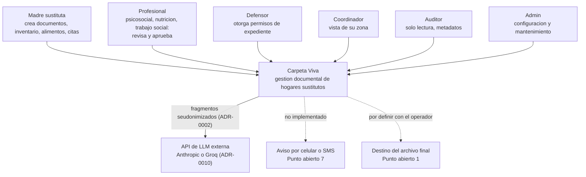
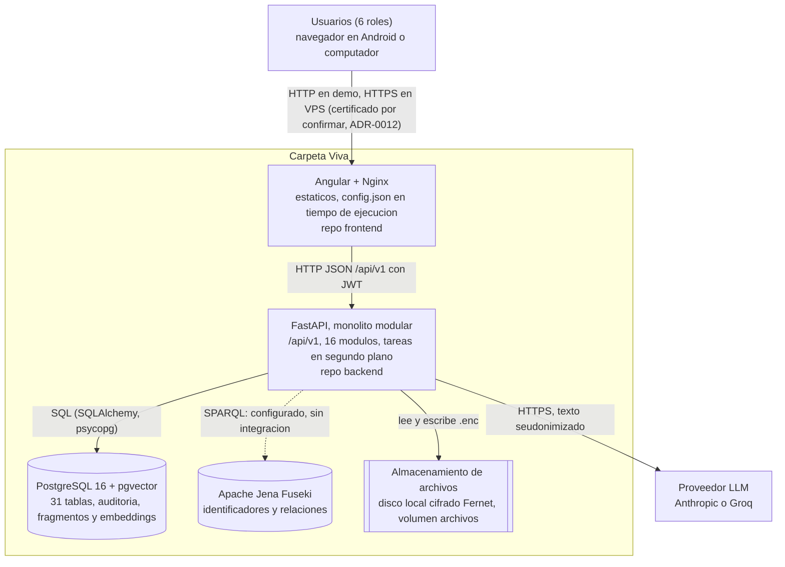
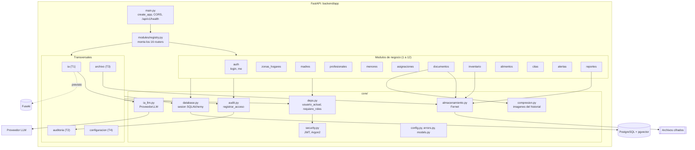

# Diagramas C4 (contexto, contenedores, componentes)

Fuentes: `CLAUDE.md`, `docs/modulos.md`, ADR-0001, ADR-0002, ADR-0003, ADR-0005, ADR-0006, ADR-0010, ADR-0012, `backend/app/modules/registry.py`, `backend/app/core/*.py`, `docker-compose.yml`. Solo datos sintéticos.

Los diagramas usan `flowchart` de Mermaid con la convención de niveles C4. La sintaxis `C4Context` de Mermaid es experimental y no siempre se muestra bien en GitHub. Línea punteada significa "previsto, sin integración implementada".

## Nivel 1: contexto del sistema

Roles reales del sistema: `madre`, `profesional`, `defensor`, `coordinador`, `auditor`, `admin` (`backend/app/modules/auth/domain.py`, enumeración `Rol`). Familia biológica, salud y educación son actores indirectos y no inician sesión (CLAUDE.md).

Notas:
- Hay un solo sistema externo implementado: el proveedor del LLM, intercambiable detrás de `ProveedorLLM` (`core/ia_llm.py`). Por defecto los datos salen seudonimizados; datos reales solo con contrato (ADR-0002 puntos 3 y 4, Punto abierto 3).
- SMS o notificación al celular: `alertas_destinatarios.notificado_en` está reservada y siempre es NULL (`alertas/models.py`). Punto abierto 7.
- Destino del archivo final: hoy el paquete queda en almacenamiento local cifrado, con el destino "pendiente de definir con el operador" (`archivo/models.py`, `DESTINO_POR_DEFECTO`). Punto abierto 1.
- No hay integraciones con ICBF, salud ni educación por ahora (CLAUDE.md, Punto abierto 8).
- Punto abierto 6: autenticación solo con usuario y contraseña (JWT); el segundo factor no está decidido.

## Nivel 2: contenedores

| Contenedor | Tecnología y detalle | Fuente |
|---|---|---|
| Angular + Nginx | Archivos estáticos con carga diferida por módulo; `config.json` con `apiUrl` leído al iniciar y nunca en caché; en VPS lo enruta Traefik, en demo Nginx proxea `/api/` | ADR-0005, ADR-0012, `infra/nginx/default.conf` |
| FastAPI | Un solo despliegue; módulos por `registry.py`; `BackgroundTasks` para indexación de IA (OCR, clasificación, embeddings); embeddings locales; Tesseract local para OCR | ADR-0001, ADR-0010, `ia/ocr.py` |
| PostgreSQL + pgvector | Imagen `pgvector/pgvector:pg16`; extensiones `vector` y `pgcrypto` | `docker-compose.yml`, `infra/postgres/init/001-extensiones.sql` |
| Fuseki | Imagen `secoresearch/fuseki:6.2.0`, dataset `ds`; solo identificadores y relaciones; nunca expuesto a red pública | ADR-0003, ADR-0006, `docker-compose.yml` |
| Archivos | Directorio `ARCHIVOS_DIR` (volumen `archivos`), Fernet con clave maestra en variable de entorno | ADR-0008 |
| Proveedor LLM | `ia_llm_proveedor` (por defecto `anthropic`), alternativa `groq`; claves en variables de entorno | `core/config.py`, `core/ia_llm.py` |

Hallazgo: la integración con Fuseki figura en el diagrama original (`Contexto/arquitectura.jpeg`: "Repositorio semántico") y en `core/config.py` (`fuseki_url`), pero el backend aún no escribe ni consulta triples (`ia/application.py`, docstring). Por eso la flecha es punteada.

## Nivel 3: componentes del backend

Los 16 módulos son los de `backend/app/modules/registry.py` (`MODULOS`), en ese orden: auth, zonas_hogares, madres, profesionales, menores, asignaciones, documentos, inventario, alimentos, citas, alertas, configuracion, reportes, ia, auditoria, archivo. Correspondencia con `docs/modulos.md`: módulos 1 a 12 de negocio, T1 Asistente de IA (`ia`), T2 Auditoría, T3 Archivo y Cierre, T4 Configuración administrable (ADR-0013).

Cómo leer el diagrama:
- Cada módulo tiene `api.py`, `application.py`, `domain.py`, `repository.py`, `schemas.py` y `models.py`; `core/` aporta lo transversal (autenticación, auditoría, sesión de base, cifrado de archivos, cliente LLM).
- `core/models.py` importa los modelos de todos los módulos para que Alembic vea el esquema completo.
- Las dependencias entre módulos (llamadas entre capas de aplicación) no se dibujan aquí para mantener la lectura; están en `fronteras-modulos.md`.
- `core/audit.py` escribe en la tabla de `auditoria`, por lo que `core` depende del módulo `auditoria` y de `auth` (hallazgo en `fronteras-modulos.md`).
- `compresion.py` lo usa `documentos` al reemplazar versiones (ADR-0011); `almacenamiento.py` lo usan `documentos`, `inventario` (fotos, ADR-0014), `reportes` (informes exportados) y `archivo` (paquete).

## Puntos abiertos que tocan estos diagramas

- Punto abierto 1: destino y formato del archivo final del expediente.
- Punto abierto 3 y 4: IA externa y datos en nube pública o con transferencia internacional.
- Punto abierto 6: segundo factor de autenticación.
- Punto abierto 7: aviso adicional de evasión por celular o SMS (costo y proveedor sin definir).
- Punto abierto 8: sin GPU declarada (IA por API) y presupuesto sin definir.
