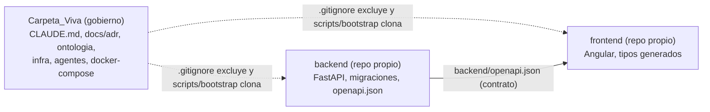
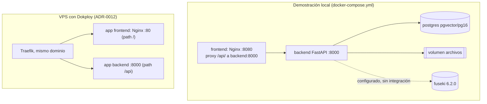

# Estructura general de la arquitectura

Fuentes: `CLAUDE.md`, ADR-0001, ADR-0005, ADR-0012, `Contexto/arquitectura.jpeg`, `backend/app/main.py`, `backend/app/modules/registry.py`, `docker-compose.yml`, `infra/nginx/default.conf`. Solo datos sintéticos.

## 1. Decisión de fondo: monolito modular (ADR-0001)

- Un solo proceso backend (FastAPI) y un solo despliegue. Razón (ADR-0001): equipo de 2 desarrolladores, 35 hogares y capacidad objetivo de 1000 usuarios simultáneos.
- Escalado: replicar el proceso detrás de un balanceador (ADR-0001, ADR-0012 sección Consecuencias). No hay balanceador ni réplicas configuradas hoy.
- Si un módulo crece, puede extraerse porque las fronteras ya están definidas (ADR-0001).
- `app/main.py` crea la aplicación, rechaza el arranque en producción si `JWT_SECRET` o `ARCHIVOS_CLAVE_MAESTRA` conservan su valor de desarrollo (ADR-0008 sección 1) y monta los routers de los 16 módulos listados en `app/modules/registry.py` bajo `/api/v1`.

## 2. Cuatro capas

`Contexto/arquitectura.jpeg` y ADR-0001 definen cuatro capas. Así se materializan en el código:

| Capa | Qué contiene | Dónde está |
|---|---|---|
| Presentación | Angular (viewpages, DTO, JWT en memoria) | `frontend/` (repositorio aparte, ADR-0005) |
| Aplicación | Casos de uso y orquestación entre módulos; el router FastAPI es su adaptador HTTP | `backend/app/modules/<m>/api.py`, `application.py`, `schemas.py` |
| Dominio | Entidades, enumeraciones y reglas de negocio puras | `backend/app/modules/<m>/domain.py` |
| Persistencia e infraestructura | Repositorios, modelos ORM, almacenamiento cifrado, cliente LLM | `repository.py`, `models.py`, `backend/app/core/` |

Flujo de una petición: `api.py` (valida el esquema y el rol de entrada) -> `application.py` (autorización fina por fila, auditoría) -> `domain.py` (reglas) y `repository.py` (SQLAlchemy). Cada módulo agrupa sus seis archivos en `backend/app/modules/<modulo>/`.

Nota de lectura del diagrama (hallazgo): `Contexto/arquitectura.jpeg` dibuja la capa de presentación Angular dentro del monolito y la "Base de datos unificada (PostgreSQL & Triple Store)". ADR-0005 (posterior) separa el frontend en un despliegue independiente. Vale ADR-0005; el diagrama es de la fase de definición.

## 3. Comunicación entre módulos: solo por la capa de aplicación

Regla (ADR-0001, `backend/CLAUDE.md`): los módulos se comunican solo por casos de uso de la capa de aplicación o por interfaces de repositorio.

Cómo se cumple en el código:
- Un módulo llama a funciones públicas de `application.py` de otro (por ejemplo `menores.application.puede_ver_menor`, `tiene_permiso_seccion`, `zonas_hogares.application.puede_ver_hogar`).
- Los ciclos entre módulos (por ejemplo `menores` <-> `asignaciones`, `documentos` <-> `ia`) se resuelven con importaciones dentro de la función (así lo documentan los docstrings de `zonas_hogares/application.py`, `ia/application.py`, `documentos/application.py`).
- El Asistente de IA nunca consulta pgvector ni el grafo sin resolver antes los permisos con esas funciones (ADR-0002, ADR-0010, `ia/application.py`).
- Funciones "internas" sin autorización (`*_interno`) existen solo para otros módulos (por ejemplo `archivo` y `alertas`) y no se exponen en `api.py`.

Excepciones detectadas (revisión de imports reales, detalle en `fronteras-modulos.md`): hay accesos directos a repositorios, modelos o dominio de otro módulo en `asignaciones`, `zonas_hogares`, `ia`, `menores` y `documentos`, y el paquete `core` depende del módulo `auth`. Son desviaciones de la regla; no se ha decidido corregirlas (sin ADR).

## 4. Repositorios separados (ADR-0005)

- Carpeta_Viva no contiene código de aplicación (CLAUDE.md, ADR-0005). No se usan submódulos de Git.
- Cada repositorio tiene un `CLAUDE.md` corto que apunta a Carpeta_Viva (`backend/CLAUDE.md`, `frontend/CLAUDE.md`).
- Los cambios que cruzan repositorios se anotan como ADR en `docs/adr/` (ADR-0005).
- Remotos mencionados en `docs/plan-por-fases.md`: `canon4/carpeta-viva-backend` y `canon4/carpeta-viva-frontend`. Inconsistencia: CLAUDE.md lista como Punto abierto 10 las "URLs de los repositorios remotos", mientras el plan de fases lo marca como hecho.

## 5. Contrato de API: OpenAPI bajo `/api/v1`

- Todo endpoint cuelga de `settings.api_prefix = "/api/v1"` (`core/config.py`, `main.py`).
- `backend/openapi.json` se genera con `python scripts/export_openapi.py` y una prueba falla si está desactualizado (ADR-0005). Hoy contiene 111 rutas y 137 operaciones (ver `../03-diseno/rutas-api.md`).
- El frontend genera sus tipos con `npm run api:types` en `frontend/src/app/core/api/schema.d.ts`; no se escriben tipos a mano (`frontend/CLAUDE.md`, `docs/guia-api.md`).
- Un cambio incompatible exige `/api/v2` (ADR-0005). No existe `/api/v2`.
- Códigos de error usados: 401 sin token o token inválido, 403 sin permiso (nunca se oculta con 404), 404, 422 (`docs/guia-api.md`).

## 6. Frontend desacoplado con Nginx y `config.json`

- Angular se compila a archivos estáticos (`dist/frontend/browser`) servidos por Nginx y se despliega sin tocar el backend (ADR-0005).
- Carga diferida por módulo: `frontend/src/app/app.routes.ts` registra 15 módulos con `loadChildren` (zonas-hogares, madres, profesionales, menores, asignaciones, documentos, inventario, alimentos, citas, alertas, reportes, ia, archivo, auditoria, configuracion) más `login` y `panel` con `loadComponent`. `configuracion` exige el guard `rolGuard('admin')`.
- La dirección de la API se lee en tiempo de ejecución de `config.json` (`apiUrl: "/api/v1"`), nunca se compila ni se cachea: `infra/nginx/default.conf` sirve `/config.json` e `/index.html` con `Cache-Control: no-store` y los archivos con hash con caché larga.
- Cabeceras de Nginx de demo: `X-Content-Type-Options`, `X-Frame-Options DENY`, `Referrer-Policy no-referrer`, `client_max_body_size 50m`.
- El token JWT vive solo en memoria (`docs/guia-api.md`, `frontend/CLAUDE.md`). El esquema definitivo lo define `seguridad` (frontend/CLAUDE.md).

## 7. Dos topologías de despliegue

- Demo local: `docker-compose.yml` levanta postgres, fuseki, backend y frontend; el servicio `seed` (perfil `demo`) carga datos sintéticos.
- VPS (ADR-0012): un proyecto Dokploy con dos aplicaciones independientes, ruteo por path en Traefik (`/api` al backend, `/` al frontend); el Nginx del frontend de Dokploy no proxea la API; `config.json` se genera al arrancar el contenedor. Despliegue por webhook desde GitHub Actions.
- Postgres y Fuseki en el VPS quedan fuera de ADR-0012 ("se decide aparte").

## 8. Puntos abiertos que afectan esta estructura

- Punto abierto 4 (CLAUDE.md): datos en nube pública y posible transferencia internacional; el VPS propio mitiga, pero el proveedor del LLM (ver `diagramas-c4.md`) sigue siendo externo.
- Punto abierto 8: sin GPU declarada; IA por API; presupuesto sin definir.
- Punto abierto 6: segundo factor para profesionales; hoy solo usuario y contraseña (el hash de contraseña usa Argon2, `core/security.py`).
- Punto abierto 3 (ADR-0002): IA externa anonimizada por defecto; datos reales solo con contrato.
- Sin definir en ningún ADR: escalado horizontal efectivo, cola de tareas (hoy `BackgroundTasks` en el mismo proceso) y prueba de carga a 1000 usuarios (Fase 5 del plan).
