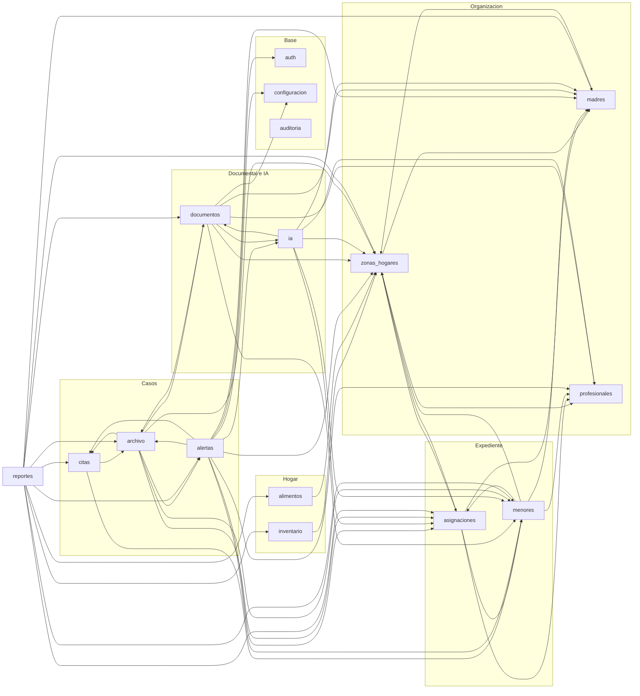

# Fronteras entre módulos

Fuentes: `docs/modulos.md`, `backend/app/modules/registry.py`, `backend/app/modules/*/models.py`, `backend/app/modules/*/application.py`, `backend/openapi.json`, ADR-0001, ADR-0008, ADR-0010, ADR-0013. Las dependencias salen de revisar los `import` reales (incluidos los hechos dentro de funciones). Solo datos sintéticos.

## 1. Tabla por módulo

Los 16 módulos son los de `MODULOS` en `registry.py`. "Endpoints" cuenta operaciones (método más ruta) de `openapi.json`, incluido el diagnóstico `GET /<módulo>/_estado` que existe en cada uno. "Depende de" lista los módulos cuyas funciones de `application.py` (o `domain.py`) importa; todos dependen además de `auth.domain.Rol` y de `core/`.

| # | Módulo (carpeta) | Responsabilidad | Tablas que posee | Prefijo (`/api/v1`) y operaciones | Depende de (capa de aplicación) |
|---|---|---|---|---|---|
| 1 | `auth` (Autenticación y Accesos) | Inicio de sesión JWT, usuario actual, consulta de usuarios por rol (la usa `alertas`) | `usuarios` | `/auth` (3) | ninguno |
| 2 | `zonas_hogares` (Zonas y Hogares) | Zonas, hogares, capacidad, autorización de lectura y gestión por hogar (`puede_ver_hogar`, `puede_gestionar_hogar`) | `zonas`, `hogares_sustitutos` | `/zonas-hogares` (9) | `asignaciones`, `profesionales`, `madres` |
| 3 | `madres` (Madres Sustitutas) | Perfil, certificación, firma única (`firma_ref`) | `madres_sustitutas` | `/madres` (7) | `zonas_hogares` |
| 4 | `profesionales` (Profesionales) | Datos del profesional y consulta de quién atiende a cada menor (`esta_asignado_a_menor`, `es_defensor_asignado`) | `profesionales`, `menores_profesionales` | `/profesionales` (5) | ninguno |
| 5 | `menores` (Menores y Expedientes) | Expediente, historial, familiares, permisos por sección (`puede_ver_menor`, `tiene_permiso_seccion`), paneles | `menores`, `menores_history`, `menores_familiares`, `permisos_expediente` | `/menores` (13) | `asignaciones`, `zonas_hogares`, `profesionales`, `madres` |
| 6 | `asignaciones` (Asignaciones y Traslados) | Ingreso, traslado, egreso, historial; revoca permisos de la madre saliente (RF7) | `asignaciones`, `asignaciones_history` | `/asignaciones` (7) | `zonas_hogares`, `profesionales`, `menores`, `madres` |
| 7 | `documentos` (Gestión Documental) | Carga cifrada, versionado, flujo madre crea y profesional revisa, reportes clínicos, visor | `documentos`, `documentos_versiones`, `reportes` | `/documentos` (17) | `ia`, `zonas_hogares`, `madres`, `menores`, `profesionales`, `configuracion`, `archivo` |
| 8 | `inventario` (Inventario del Hogar) | Camas y muebles (pedido y recepción), fotos de evidencia, convivientes, red de apoyo | `inventario_items`, `inventario_item_fotos`, `hogar_convivientes`, `hogar_red_apoyo` | `/inventario` (15) | `zonas_hogares` |
| 9 | `alimentos` (Control de Alimentos) | Ingreso de mercado, vencimiento, checklist reutilizable | `alimentos_items`, `alimentos_checklist_items` | `/alimentos` (9) | `zonas_hogares` |
| 10 | `citas` (Citas y Recordatorios) | Registro y recordatorio de citas; no las asigna | `citas` | `/citas` (7) | `menores`, `archivo` |
| 11 | `alertas` (Alertas y Evasiones) | Evasión, alertas automáticas (visita vencida, documento faltante, indexación pendiente), destinatarios y vistos | `alertas`, `alertas_destinatarios` | `/alertas` (9) | `configuracion`, `profesionales`, `asignaciones`, `auth`, `zonas_hogares`, `madres`, `archivo`, `menores`, `citas`, `ia` |
| 12 | `configuracion` (T4, ADR-0013) | Catálogos y parámetros editables por `admin` | `catalogos_opciones`, `configuracion_sistema` | `/configuracion` (10) | ninguno |
| 13 | `reportes` (Reportes) | Reportes general, por zona, por menor, por madre; exportación | `informes_generados` | `/reportes` (8) | `madres`, `zonas_hogares`, `alertas`, `alimentos`, `asignaciones`, `documentos`, `menores`, `citas`, `inventario`, `archivo` |
| 14 | `ia` (T1, Asistente de IA) | OCR, clasificación, embeddings, RAG con citas, resúmenes, apoyo a la redacción | `fragmentos_documento`, `ia_consultas` | `/ia` (10) | `menores`, `zonas_hogares`, `madres`, `asignaciones`, `documentos`, `profesionales` |
| 15 | `auditoria` (T2) | Consulta de accesos auditados; el registro lo escribe `core/audit.py` | `auditoria_accesos` | `/auditoria` (2) | ninguno |
| 16 | `archivo` (T3, Archivo y Cierre) | Cierre del expediente, paquete verificable, bloqueo de escritura | `expedientes_archivo` | `/archivo` (5) | `asignaciones`, `zonas_hogares`, `citas`, `documentos`, `alertas`, `menores` |

Fuera de módulos: `GET /api/v1/health` (1 operación, en `main.py`). Total: 137 operaciones sobre 111 rutas; 120 de negocio más 16 diagnósticos `_estado` más `health`.

Las 31 tablas del esquema quedan repartidas sin solapamiento entre los 16 módulos. La tabla `reportes` (informe clínico) pertenece a `documentos`; no confundir con el módulo `reportes`, cuya tabla es `informes_generados` (docstring de `reportes/models.py`).

## 2. Grafo de dependencias entre módulos (capa de aplicación)

Flecha A -> B: A importa funciones de `application.py` de B.

Lectura:
- Módulos hoja (no importan a otros): `auth`, `configuracion`, `auditoria`, `profesionales`. Son la base estable.
- Módulos de lectura por hogar (`inventario`, `alimentos`) solo dependen de `zonas_hogares`.
- `reportes` es un consumidor puro: depende de 10 módulos y ninguno depende de él.
- `menores` y `zonas_hogares` son los centros de autorización: casi todos los módulos llaman a `puede_ver_menor`, `tiene_permiso_seccion` o `puede_ver_hogar`.
- Ciclos a nivel de aplicación: `zonas_hogares` <-> `asignaciones`, `zonas_hogares` <-> `menores`, `zonas_hogares` <-> `madres`, `menores` <-> `asignaciones`, `documentos` <-> `ia`, `documentos` <-> `archivo`, `citas` <-> `archivo`, `alertas` <-> `archivo`. Se resuelven con importaciones dentro de la función; funcionan, pero indican que la política de visibilidad (quién ve qué) está repartida entre `menores` y `zonas_hogares`.

## 3. Reglas de dependencia vigentes

Salen de ADR y de convenciones escritas en el código; no se inventan reglas nuevas.

| Regla | Fuente |
|---|---|
| R1. Los módulos solo se comunican por casos de uso de la capa de aplicación o interfaces de repositorio. | ADR-0001, `backend/CLAUDE.md` |
| R2. Cada módulo es dueño de sus tablas; otro módulo no las toca directamente. | ADR-0013 sección 0 (caso de `configuracion`), `backend/CLAUDE.md` |
| R3. Las funciones `*_interno` (sin autorización) son para otros módulos y no se exponen en `api.py`. | docstrings de `menores`, `asignaciones`, `citas`, `alertas`, `documentos` |
| R4. La autorización de lectura se reutiliza llamando a `menores.puede_ver_menor`, `menores.tiene_permiso_seccion` y `zonas_hogares.puede_ver_hogar`; no se duplica. | ADR-0008 sección 4, ADR-0009 sección 0 |
| R5. La IA consulta solo por la capa de aplicación y resuelve permisos antes de tocar pgvector o Fuseki; vuelve a validar el acceso al leer. | ADR-0002, ADR-0003, ADR-0010 sección 1.4, `ia/models.py` |
| R6. `configuracion` no contiene lógica de negocio; los demás módulos usan solo `configuracion.application`. | ADR-0013 sección 0 |
| R7. Todo acceso (concedido o denegado) se audita con `registrar_acceso`. | ADR-0008 sección 6, ADR-0004 |
| R8. Un expediente archivado bloquea escrituras nuevas: `documentos`, `alertas` y `citas` consultan `archivo.esta_archivado`. | ADR-0010 sección 3.2 |
| R9. El rol `auditor` nunca lee contenido (archivos, paquetes, informes, consultas de IA en texto completo); solo metadatos. | ADR-0007 punto 3, ADR-0008 sección 4, ADR-0010 |
| R10. Los ciclos entre módulos se rompen con importaciones locales a la función. | docstrings de `zonas_hogares/application.py`, `ia/application.py`, `documentos/application.py` |

## 4. Desviaciones detectadas respecto de R1 y R2

Revisión de imports reales. Ninguna tiene ADR que la justifique.

| Dónde | Qué importa | Observación |
|---|---|---|
| `asignaciones/repository.py` (línea 10) | `zonas_hogares.models.HogarSustituto` | Un repositorio consulta el modelo de otro módulo |
| `asignaciones/application.py` (línea 91) | `madres.repository.MadreRepository` | Salta la capa de aplicación de `madres` |
| `zonas_hogares/application.py` (línea 83) | `madres.repository.MadreRepository` | Idem |
| `menores/application.py` (línea 402) | `auth.repository.UsuarioRepository` | Idem; existe `auth.application.usuarios_por_rol` para otro caso |
| `ia/application.py` (varias líneas) | `documentos.repository`, `documentos.domain`, `documentos.models.Reporte` | Salta la capa de aplicación de `documentos` |
| `ia/seudonimizacion.py` (líneas 25 a 27) | modelos de `madres`, `menores`, `profesionales` | Lee tablas ajenas para construir el índice de nombres a seudonimizar |
| `documentos/domain.py` (línea 53) | `configuracion.application` | La capa de dominio llama a la capa de aplicación de otro módulo (inversión de capas) |
| `core/deps.py` | `auth.models`, `auth.repository`, `auth.domain` | El paquete `core` depende de un módulo de negocio |
| `core/audit.py` | `auditoria.models` | Idem (`core` depende de `auditoria`) |
| Todos los `api.py` | `auth.models.Usuario`, `auth.domain.Rol` | Tipos compartidos; en la práctica `auth` es un núcleo compartido |

Impacto: los cambios de esquema en `madres`, `documentos`, `menores` o `auth` pueden romper `asignaciones`, `zonas_hogares` e `ia` sin pasar por un contrato de aplicación.

Sugerencia (requiere ADR antes de adoptarla, no es una decisión): exponer funciones públicas en las capas de aplicación afectadas (por ejemplo `madres.application.por_id`, `documentos.application.listar_por_menor`) y mover la política de visibilidad (`puede_ver_*`) a un único punto compartido para eliminar los ciclos.

## 5. Observaciones de completitud por módulo

- `profesionales`: la tabla `menores_profesionales` se lee (`esta_asignado_a_menor`, `profesionales_asignados_a_menor`) pero ningún endpoint ni función de aplicación la escribe; solo el script de datos sintéticos (`backend/scripts/seed_sintetico.py`) y los helpers de prueba. De esa tabla salen permisos, paneles y destinatarios de evasión (`docs/modulos.md` módulo 4), así que falta el caso de uso de asignar profesional a menor. Pregunta para `arquitecto` y `backend`: ¿se agrega un endpoint (ADR) o se mantiene como carga administrativa?
- `auth`: solo `POST /auth/login` y `GET /auth/me`; no hay endpoints para crear usuarios ni cambiar contraseña (el plan de Fase 1 los incluye). Los usuarios se crean por el script de datos sintéticos.
- `alertas`: `domain.TIPOS_ALERTA` no incluye `indexacion_pendiente`, mientras `models.TIPOS_ALERTA` y la restricción de la base (migración `0006`) sí.
- `documentos`: `seccion_expediente` fija las categorías por sección en `CATEGORIAS_POR_SECCION`; una categoría nueva creada por `admin` con `seccion_acceso` (ADR-0013) no aparece en `GET /documentos/menor/{id}/seccion/{seccion}`, aunque `seccion_de_categoria` sí la resuelve para autorizar.
