# Diagramas de clases y de estado

Fuentes: `backend/app/modules/*/models.py` (entidades), `backend/app/modules/*/domain.py` (enumeraciones y reglas), `backend/app/modules/*/application.py` (transiciones), ADR-0004, ADR-0007, ADR-0008, ADR-0009, ADR-0010, ADR-0014, ADR-0015. Solo datos sintéticos.

Convenciones:
- Cada clase es una entidad ORM de SQLAlchemy y corresponde a una tabla (ver `modelo-er.dbml`). Los atributos son los principales; las columnas completas y los tipos exactos están en el DBML.
- Todas las entidades tienen `id` (uuid); las que usan el mixin `Timestamps` tienen además `created_at` y `updated_at`, omitidos aquí.
- Las enumeraciones se dibujan con `<<enumeration>>`. Algunas son `Enum` de Python (`Rol`, `EstadoMenor`, `TipoDocumento`, `Parentesco`, `EstadoVital`, `SeccionSensible`, `TipoMovimiento`, `EstadoAsignacion`); otras son tuplas de constantes con CHECK en la base (`TIPOS_ALERTA`, `TIPOS_CITA`, etc.); otras son solo convención de código sin CHECK (`estado_flujo` sí tiene CHECK; `hogares_sustitutos.estado` no).
- Las relaciones con `-->` son claves foráneas.

## 1. Identidad, organización y auditoría

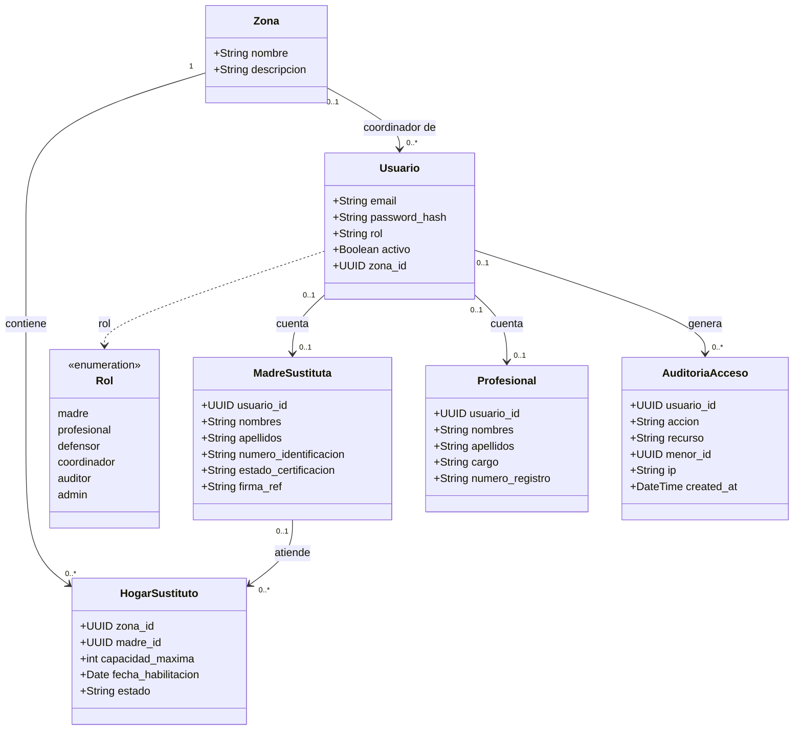

Notas:
- `cargo` de `Profesional` toma los valores `defensor`, `psicosocial`, `nutricion`, `trabajo_social` (comentario en `profesionales/models.py`); no hay CHECK ni enumeración en el código.
- El rol `defensor` existe como rol de usuario (`Rol`) y como cargo de profesional. Las reglas lo tratan igual que `profesional` en casi todo, y solo el defensor asignado puede otorgar y revocar permisos de expediente (`menores.application.crear_permiso`, ADR-0007 punto 5).
- `AuditoriaAcceso.menor_id` no es clave foránea.

## 2. Expediente del menor y asignaciones

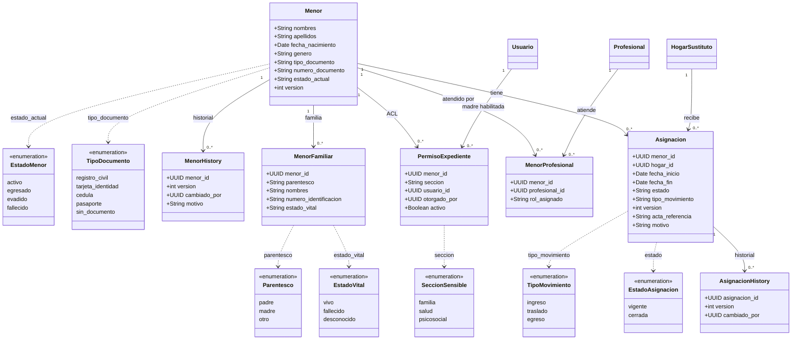

Reglas de dominio que no se ven en el esquema:
- Un menor tiene a lo sumo una `Asignacion` vigente; un traslado cierra la vigente y crea otra (`asignaciones.application.crear_asignacion`). La base no lo impone.
- Al cerrar o trasladar, se revocan los permisos de expediente de la madre saliente (`permisos_expediente.activo = false`, RF7) y, en el cierre, `Menor.estado_actual` pasa a `egresado`.
- `CAMPOS_TRACKEADOS` en `menores/domain.py` (nombres, apellidos, fecha de nacimiento, género, tipo y número de documento, estado) decide cuándo se escribe `MenorHistory`.
- `MenorFamiliar` pertenece siempre a la sección sensible `familia`.
- Ni `crear_menor` ni la API crean registros `MenorProfesional`; ver observaciones al final.

## 3. Gestión documental

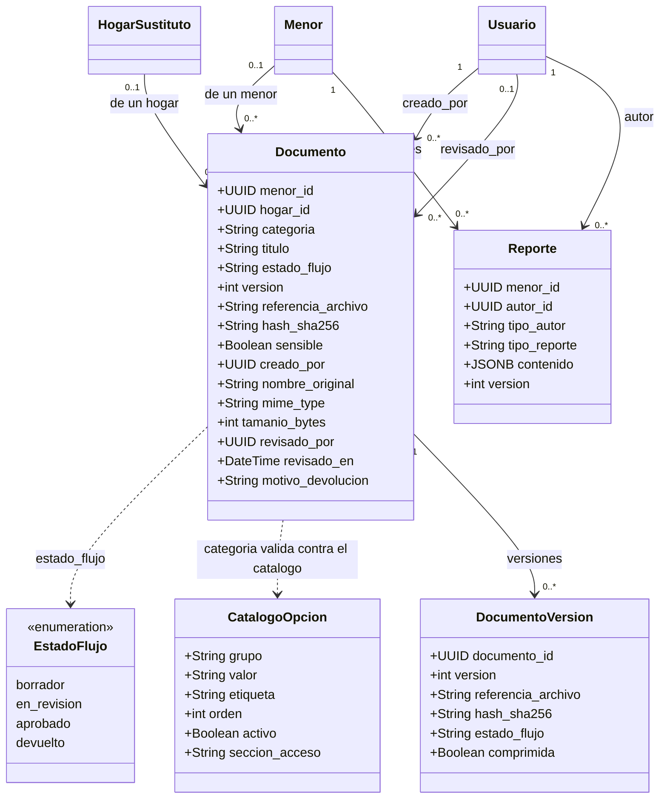

Mapeos de sección (`documentos/domain.py`):

| Categoría documental (menor) | Sección de permiso |
|---|---|
| `identidad`, `educacion`, `actas_traslados`, `otros` | ninguna (visibilidad básica) |
| `salud` | `salud` |
| `psicosocial` | `psicosocial` |
| `familia_red_apoyo` | `familia` |

Categorías de hogar: `madre_habilitacion`, `otros`. El conjunto de categorías ya no es fijo en código: vive en `catalogos_opciones` (grupos `categoria_documento_menor` y `categoria_documento_hogar`, ADR-0013) y `admin` puede agregar categorías. Las categorías documentales siguen siendo provisionales hasta validarlas con el operador (ADR-0008 sección 2, CLAUDE.md).

| Tipo de reporte | Sección |
|---|---|
| `informe_medico`, `informe_nutricion` | `salud` |
| `informe_psicosocial` | `psicosocial` |
| `informe_trabajo_social` | `familia` |
| `seguimiento` | ninguna |

`Reporte` no sigue el flujo de aprobación: lo crea el profesional o defensor asignado y queda definitivo (ADR-0008 sección 3).

## 4. Vida del hogar: inventario y alimentos

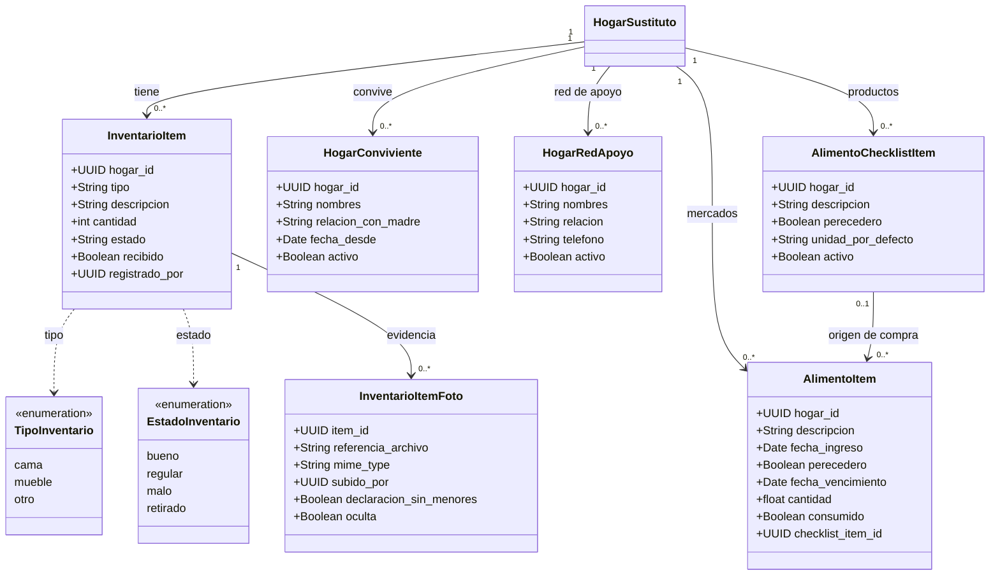

Reglas de dominio:
- Pedido y recepción (ADR-0014): el coordinador crea un ítem con `recibido = false`; la madre o `admin` confirma la llegada con su estado físico (`PUT /inventario/items/{id}/recepcion`), una sola vez. Madre y `admin` que crean directo registran `recibido = true`.
- Alimentos (ADR-0015): solo madre y `admin` escriben; coordinador, profesional, defensor y auditor solo leen (`alimentos.application._puede_gestionar_alimentos`). Un alimento perecedero exige fecha de vencimiento (`alimentos.domain.validar_perecedero`).
- Las fotos de inventario solo las leen madre, `admin` y auditor, y solo `admin` ve las ocultas (`inventario.application`).

## 5. Citas y alertas

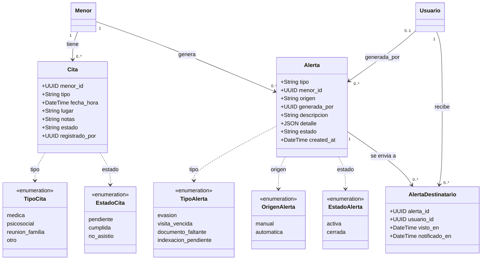

Reglas de dominio:
- Dueño por tipo de cita (ADR-0015, `citas.application._rol_propietario`): `reunion_familia` la escribe el defensor; las demás (`medica`, `psicosocial`, `otro`) las escribe la madre; `admin` siempre puede. El sistema no asigna citas, solo recuerda.
- `Cita.notas` se entrega como `null` si el solicitante no tiene permiso de sección para el tipo de cita (ADR-0009 sección 2).
- Evasión: destinatarios = profesionales asignados con rol `defensor` o `psicosocial` (`ROLES_DESTINATARIOS_EVASION`); si no hay ninguno con cuenta, cae al coordinador de la zona y después a `admin`. `notificado_en` está reservada y siempre es NULL (Punto abierto 7).
- Visita vencida y documento faltante se generan automáticamente, sin duplicar una alerta activa por la misma causa. `indexacion_pendiente` marca documentos sin indexar en IA por más del umbral (60 minutos por defecto).
- Con el expediente archivado no se crean citas, alertas, documentos ni reportes nuevos (ADR-0010 sección 3.2).

## 6. IA, reportes, archivo y configuración

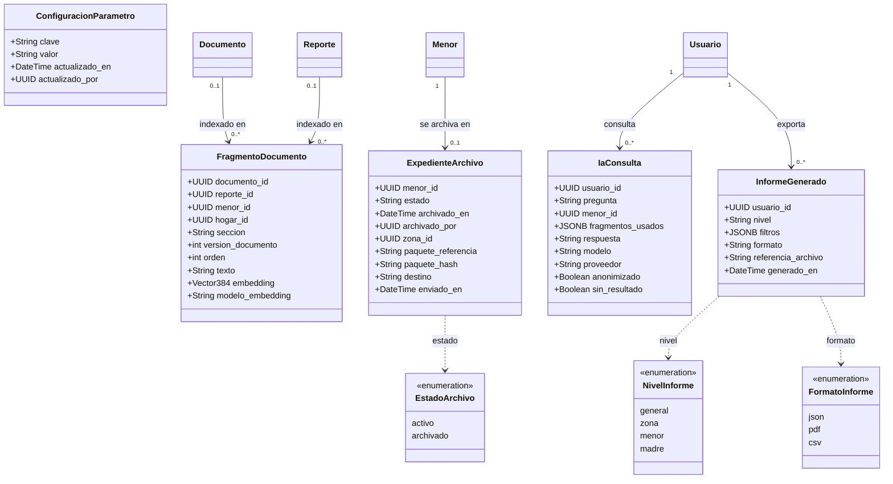

Reglas de dominio:
- `FragmentoDocumento` apunta a un `Documento` o a un `Reporte`, nunca a ambos ni a ninguno (CHECK `ck_fragmentos_documento_documento_xor_reporte`). Sus campos `menor_id`, `hogar_id` y `seccion` acotan la búsqueda pero no sustituyen la autorización (ADR-0010 sección 1.4).
- La condición de archivo (`archivo.domain.condicion_archivo_cumplida`): el menor está `egresado` o `fallecido` y no tiene asignación vigente. `evadido` no dispara archivo.
- `ExpedienteArchivo.destino` vale hoy "almacenamiento local cifrado - destino externo pendiente de definir con el operador" (Punto abierto 1).
- Al exportar un informe se congelan las secciones sensibles incluidas en `filtros`, y al descargar se revalidan los permisos vigentes (ADR-0010 sección 2).

## 7. Diagramas de estado

### 7.1 Documento (`Documento.estado_flujo`)

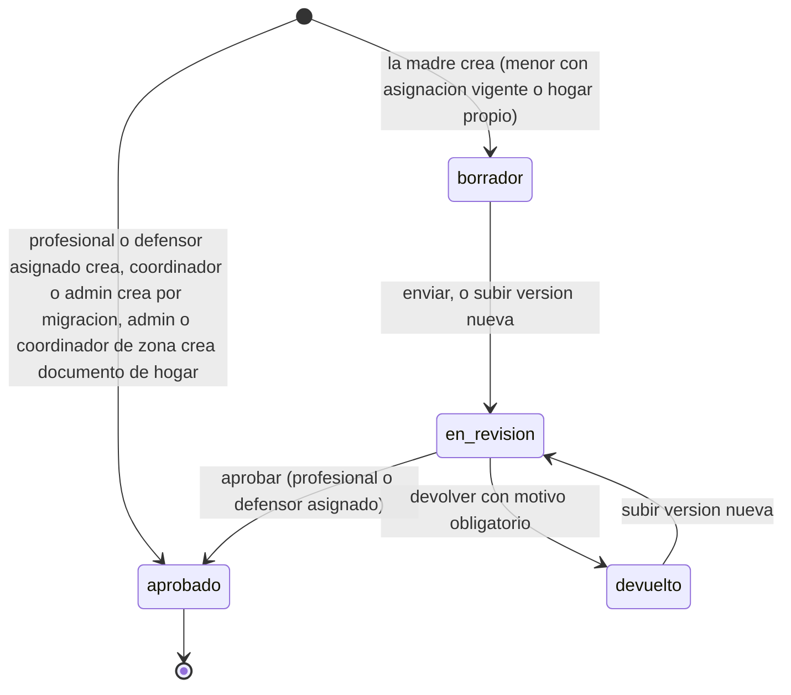

Reglas (`documentos.application`, ADR-0008 sección 3):
- `enviar`: solo desde `borrador`, por el creador o quien tendría el mismo permiso de creación.
- `aprobar` y `devolver`: solo desde `en_revision`, por cualquier profesional o defensor asignado al menor (no se distingue el cargo; ADR-0008 lo deja como riesgo de calidad profesional, no de acceso). Los documentos de hogar no tienen revisor: `_puede_revisar` exige `menor_id`, así que un documento de hogar de la madre queda en `en_revision` sin quién lo apruebe (observación abajo).
- `subir versión`: solo en `borrador` o `devuelto`; guarda un snapshot en `documentos_versiones`, sube `version` y pasa a `en_revision` sin volver a `borrador`.
- `aprobado` es terminal: ninguna operación del código lo reabre, ni siquiera con una versión nueva.
- No existe borrado, ni siquiera en `borrador`.

### 7.2 Expediente del menor (`Menor.estado_actual` y estado de archivo)

El expediente tiene dos ejes: el estado del menor (`menores.estado_actual`) y el estado de archivo (`expedientes_archivo.estado`). El tercer estado que ADR-0004 llamaba "cerrado" no existe como tal: ADR-0007 y el código usan `egresado`, `evadido` y `fallecido`.

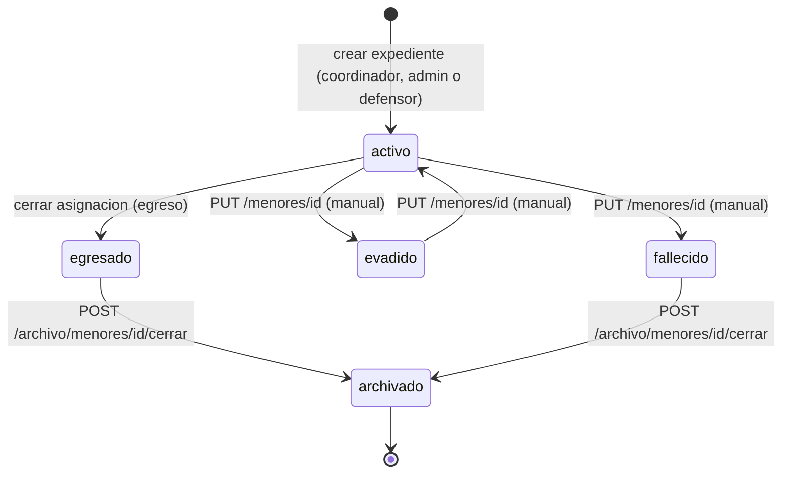

Reglas:
- La única transición automática es `activo` a `egresado`, al cerrar la asignación vigente (`asignaciones.cerrar_asignacion`, que también revoca los permisos de la madre, RF7). Las demás las hace una persona con `PUT /menores/{id}`; el código no valida qué transiciones son legales (cualquier valor de `EstadoMenor` se acepta), y cada cambio escribe un snapshot en `menores_history`.
- Registrar una alerta de evasión no cambia `estado_actual` a `evadido`; son dos acciones separadas.
- Archivar exige `estado_actual` en `egresado` o `fallecido` y ninguna asignación vigente (`condicion_archivo_cumplida`). Quién archiva: `admin` o el coordinador de la zona del expediente (el auditor solo consulta).
- `archivado` bloquea escrituras nuevas (documentos, versiones, reportes, citas, alertas). El expediente no se elimina; la madre pierde acceso desde el egreso (RF7).
- Estado de archivo posterior al archivo (`enviado_en`, destino externo): el destino final está sin definir (Punto abierto 1).

### 7.3 Asignación (`Asignacion.estado`)

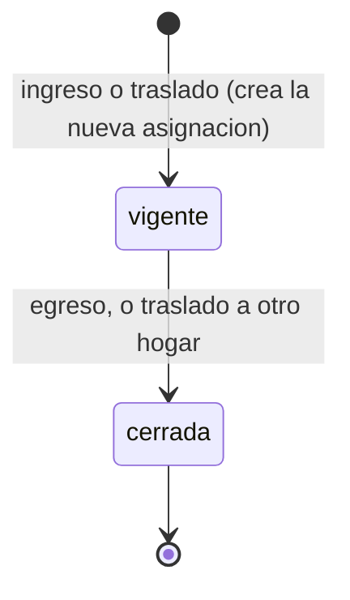

Cada cierre guarda antes un snapshot en `asignaciones_history`. En un traslado, la vigente anterior pasa a `cerrada` y se crea otra `vigente`.

### 7.4 Alerta (`Alerta.estado`)

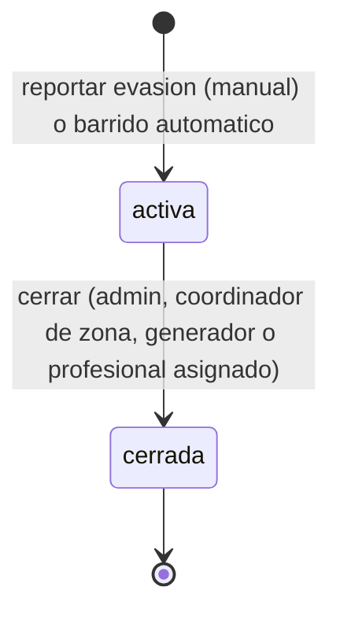

El "visto" no cambia el estado: se registra por destinatario en `alertas_destinatarios.visto_en`.

### 7.5 Cita (`Cita.estado`)

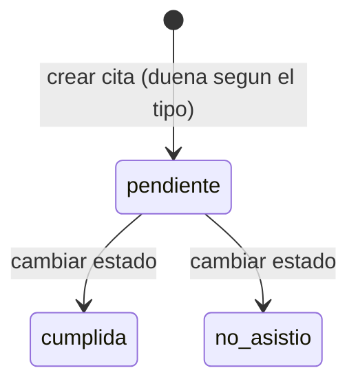

`cambiar_estado_cita` acepta cualquier valor de `ESTADOS_CITA` sin validar la transición previa (puede volver a `pendiente`). Reprogramar (`PUT /citas/{id}`) cambia fecha, lugar y notas, no el estado.

### 7.6 Ítem de inventario (pedido y recepción)

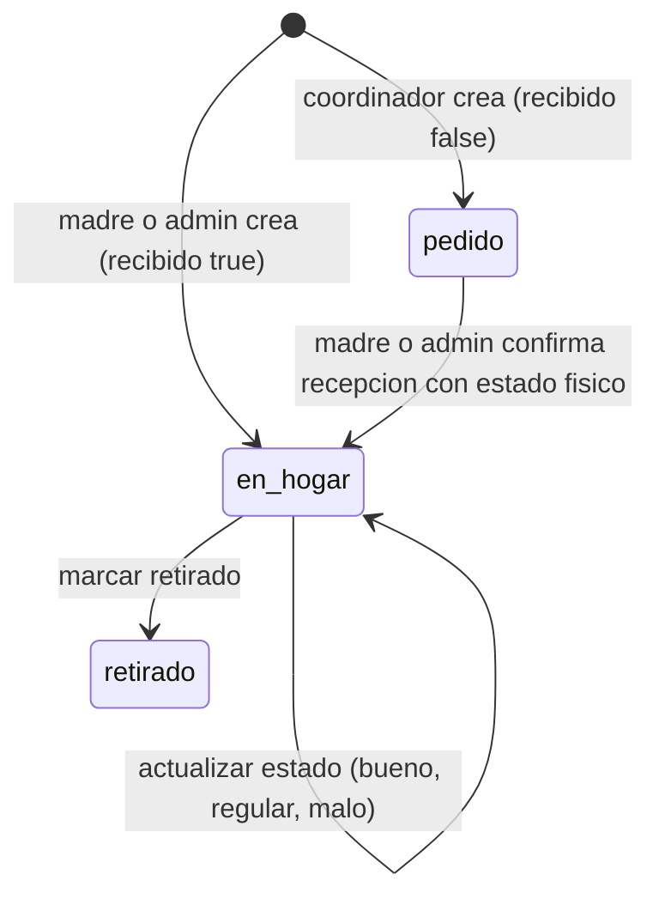

`pedido` y `en_hogar` son `recibido = false` y `recibido = true`; `retirado` es un valor de `estado`, no de `recibido`. El pedido solo se edita (tipo, descripción, cantidad) por coordinador o `admin` mientras no se haya recibido (ADR-0014).

## 8. Observaciones de coherencia entre código y documentos

- ADR-0004 define los estados del expediente como "activo, cerrado, archivado"; ADR-0007 y el código usan `activo`, `egresado`, `evadido`, `fallecido` más `archivado` en otra tabla. CLAUDE.md no los lista. Vale ADR-0007 por ser posterior, pero ADR-0004 no está marcada como reemplazada en esa parte.
- ADR-0004 prevé el flujo de documento con cinco estados (borrador, enviado, en revisión, aprobado, devuelto); ADR-0008 sección 3 lo simplifica a cuatro y el código usa cuatro. ADR-0004 sigue en estado "Propuesta".
- Documentos de hogar (por ejemplo `madre_habilitacion`): la madre los crea en `borrador` y los envía a revisión, pero la aprobación exige un profesional asignado a un menor, que no existe para un documento de hogar. Quien lo cree como `admin` o coordinador de zona nace `aprobado` y no necesita revisión. Falta definir quién revisa lo que sube la madre; no hay ADR que lo resuelva (pregunta para `arquitecto` y `seguridad`).
- `MenorProfesional` solo se escribe en el script de datos sintéticos y en helpers de prueba; no existe endpoint ni caso de uso para asignar un profesional a un menor, aunque de ahí salen permisos, paneles y destinatarios de evasión.
- `alertas.domain.TIPOS_ALERTA` no incluye `indexacion_pendiente`; `alertas/models.py` y la migración `0006` sí.
