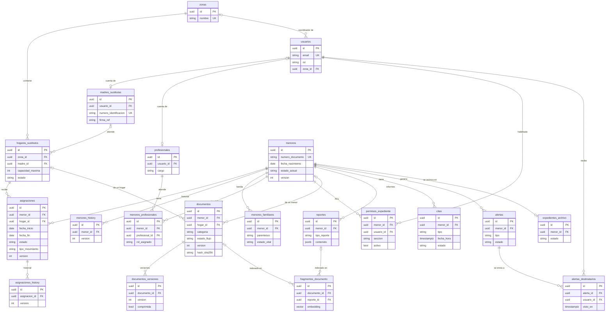

# Modelo entidad-relación

Fuentes: `backend/app/core/models.py`, `backend/app/modules/*/models.py`, `backend/migrations/versions/0001` a `0010` (head), `docs/metodologia/03-diseno/script-bd.sql`, ADR-0004, ADR-0007, ADR-0008, ADR-0009, ADR-0010, ADR-0011, ADR-0013, ADR-0014. Solo datos sintéticos.

El esquema completo y legible por máquina está en `modelo-er.dbml` (importable en dbdiagram.io): 31 tablas, todas las columnas, tipos, PK, FK, unicidades, índices y las restricciones CHECK como notas. Este documento explica el diseño. Los modelos ORM y la migración `0010` coinciden en columnas, tipos, índices y restricciones; no se encontraron diferencias. Solo varía la forma de algunos defaults: unos los aplica el código Python en vez de la base (anotados en el DBML como "default app") y las migraciones iniciales usan `CURRENT_TIMESTAMP` donde las posteriores usan `now()`, que es equivalente en PostgreSQL.

## 1. Grupos de tablas

| Grupo | Tablas | Para qué |
|---|---|---|
| Identidad, organización y auditoría (6) | `usuarios`, `zonas`, `hogares_sustitutos`, `madres_sustitutas`, `profesionales`, `auditoria_accesos` | Quién entra, dónde está cada hogar, quién es la madre y los profesionales, rastro de todo acceso (RF11, RF17) |
| Expediente del menor (5) | `menores`, `menores_history`, `menores_familiares`, `permisos_expediente`, `menores_profesionales` | Datos personales con historial, padre y madre, ACL por sección sensible y quién atiende a cada menor (RF1, RF6) |
| Asignaciones (2) | `asignaciones`, `asignaciones_history` | Vínculo menor-hogar con fecha de inicio y fin, traslados y egresos (RF1, RF7) |
| Gestión documental (3) | `documentos`, `documentos_versiones`, `reportes` | Metadatos de archivos cifrados, versiones, flujo de revisión e informes clínicos (RF2 a RF5) |
| Vida del hogar (6) | `inventario_items`, `inventario_item_fotos`, `hogar_convivientes`, `hogar_red_apoyo`, `alimentos_checklist_items`, `alimentos_items` | Inventario, personas del hogar, red de apoyo y control de alimentos (RF13, RF14) |
| Citas y alertas (3) | `citas`, `alertas`, `alertas_destinatarios` | Recordatorios de citas, evasiones y alertas con registro de quién las vio (RF9, RF15) |
| Configuración administrable (2) | `catalogos_opciones`, `configuracion_sistema` | Catálogos y parámetros editables por `admin` (ADR-0013) |
| Asistente de IA (2) | `fragmentos_documento`, `ia_consultas` | Texto y embeddings para RAG; auditoría de cada respuesta (RF12) |
| Reportes y archivo (2) | `informes_generados`, `expedientes_archivo` | Trazabilidad de exportaciones y estado de archivo y cierre (RF8, RF16) |

Total: 31 tablas.

## 2. Diagrama resumido de las entidades núcleo

Se omiten las columnas de auditoría de fila (`created_at`, `updated_at`) y las tablas de vida del hogar, configuración e IA de uso (`ia_consultas`) para que sea legible.

## 3. Patrón `*_History`

Origen: el modelo previo `Contexto/ICBF.pdf` (tablas `*_History`, CLAUDE.md). Regla: antes de modificar una fila relevante, la aplicación inserta en la tabla de historia una copia de la fila anterior y sube `version` en la fila viva. La tabla viva siempre tiene el estado actual; la historia solo crece.

| Viva | Historia | Columnas extra de la historia | Quién la escribe |
|---|---|---|---|
| `menores` | `menores_history` | `menor_id`, `version`, `cambiado_por`, `motivo`, `created_at` | `menores.application` (solo si cambia un campo trackeado) |
| `asignaciones` | `asignaciones_history` | `asignacion_id`, `version`, `cambiado_por`, `created_at` | `asignaciones.application` (cierre, traslado) |
| `documentos` | `documentos_versiones` | `documento_id`, `version`, `comprimida`, `created_at` | `documentos.application.crear_version` |

Características:
- La historia no tiene `updated_at`: es inmutable por diseño (no por restricción de base).
- `documentos_versiones` copia solo las columnas de archivo y flujo (no `titulo`, `categoria` ni `sensible`, que no cambian entre versiones).
- Para `documentos_versiones.comprimida`, ver ADR-0011.
- Tablas que no usan historia a propósito: `menores_familiares` y `citas` (la cubre `auditoria_accesos`), `reportes` (append-only, una corrección es una fila nueva), `alertas` (se cierra, no se edita) y los catálogos (se desactivan).
- La trazabilidad de quién hizo qué y cuándo no vive en las historias sino en `auditoria_accesos` (RF11).

## 4. Normalización

### 4.1 Primera forma normal (1FN)

Todas las columnas son atómicas y no hay grupos repetidos, con cuatro excepciones deliberadas de tipo JSON:

| Columna | Tipo | Justificación |
|---|---|---|
| `reportes.contenido` | `jsonb` | El informe clínico varía por `tipo_reporte` (médico, psicosocial, nutrición, trabajo social, seguimiento); su estructura no está definida (las categorías documentales aún no están definidas con el operador, CLAUDE.md). Se indexa por texto en `fragmentos_documento` para búsqueda |
| `alertas.detalle` | `json` | Datos de apoyo de la alerta automática (por ejemplo el `cita_id` que la originó); el código lo lee en Python, no filtra por campo en SQL (inferido de `alertas/application.py`) |
| `ia_consultas.fragmentos_usados` | `jsonb` | Instantánea de las citas que respaldaron una respuesta, para auditoría (ADR-0002 punto 7). La razón de que sea JSON y no una tabla hija no está escrita en un ADR; se infiere que evita que la cita histórica cambie al reindexar |
| `informes_generados.filtros` | `jsonb` | Instantánea de zona, menor, madre y secciones incluidas al exportar, necesaria para revalidar permisos al descargar (ADR-0010 sección 2) |

El vector `fragmentos_documento.embedding` es un tipo atómico de pgvector, no un grupo repetido.

### 4.2 Segunda forma normal (2FN)

Todas las tablas usan una PK simple (`id uuid`; `clave` en `configuracion_sistema`), así que no hay dependencias parciales. Las claves candidatas compuestas están declaradas como UNIQUE y los atributos dependen de la fila completa:
- `permisos_expediente (menor_id, seccion, usuario_id)`
- `menores_profesionales (menor_id, profesional_id, rol_asignado)`
- `alertas_destinatarios (alerta_id, usuario_id)`
- `catalogos_opciones (grupo, valor)`
- `fragmentos_documento (documento_id, version_documento, orden)` y la equivalente con `reporte_id`

### 4.3 Tercera forma normal (3FN) y desnormalizaciones

Relaciones muchos a muchos resueltas con tabla intermedia propia: menor-profesional con atributo (`menores_profesionales.rol_asignado`), alerta-usuario con atributos (`alertas_destinatarios.visto_en`, `notificado_en`) y menor-usuario por sección (`permisos_expediente`).

Excepciones a 3FN (atributos derivables que se guardan):

| Columna | Se podría derivar de | Por qué se guarda |
|---|---|---|
| `fragmentos_documento.menor_id`, `hogar_id`, `seccion` | `documentos` o `reportes` | Acotar la búsqueda vectorial antes de calcular similitud (ADR-0010 sección 1.4). No sustituye la autorización: toda lectura vuelve a pasar por `puede_ver_menor` y `tiene_permiso_seccion` |
| `expedientes_archivo.zona_id` | `asignaciones` -> `hogares_sustitutos` -> `zonas` | Un coordinador sin asignación vigente (el menor ya egresó) debe poder listar lo de su zona histórica (ADR-0010 sección 3, docstring del modelo) |
| `documentos.sensible` | `categoria` -> `catalogos_opciones.seccion_acceso` | Instantánea al crear; la sección de una categoría es inmutable tras su creación (ADR-0013 sección 5.1), por lo que no se desactualiza. Lo usa `GET /documentos/auditor` para excluir sensibles |
| `reportes.tipo_autor` | `usuarios.rol` de `autor_id` | Instantánea del rol cuando se escribió el informe |
| `documentos_versiones.*` y `*_history.*` | fila viva anterior | Es el propósito del patrón `*_History` |
| `inventario_item_fotos.referencia_archivo`, `documentos.hash_sha256` | el archivo cifrado | Metadato de integridad y localización; evita abrir el archivo para saber su huella |

### 4.4 Hallazgos de integridad que la base no garantiza

Reglas que hoy solo cumple la aplicación (sin CHECK, UNIQUE o FK en la base); candidatas a revisar con `backend` y `datos-infra`:
- Un menor con una sola asignación vigente: no hay índice único parcial sobre `asignaciones (menor_id) WHERE estado = 'vigente'`; lo valida `crear_asignacion`.
- `documentos` debe tener exactamente uno de `menor_id` u `hogar_id`: no hay CHECK; lo valida `crear_documento`.
- `hogares_sustitutos.madre_id` no es UNIQUE, pero el código asume un hogar por madre (`hogar_de_madre`).
- `estado` en `hogares_sustitutos`, `asignaciones` y `madres_sustitutas.estado_certificacion`, `usuarios.rol`, `profesionales.cargo`, `menores_profesionales.rol_asignado` y `reportes.tipo_reporte` no tienen CHECK; los valores válidos viven en el código.
- Coexisten `profesionales.cargo` (profesión de la persona) y `menores_profesionales.rol_asignado` (su papel con ese menor). `es_defensor_asignado` exige `cargo = 'defensor'` y asignación, pero las alertas de evasión resuelven destinatarios por `rol_asignado`. Pueden divergir; no hay regla que las alinee.
- `auditoria_accesos.menor_id` no tiene FK (referencia lógica). La tabla no está protegida contra UPDATE o DELETE y no está particionada (ADR-0004 lo preveía).
- Catálogos fijos con CHECK (tipos de alerta, de cita y de inventario, niveles de informe) frente a catálogos editables (`catalogos_opciones`, solo categorías documentales). ADR-0013 enumera los primeros como candidatos a migrar; solo se migró la categoría documental.

### 4.5 Datos sensibles en la base

El cifrado en reposo cubre solo los archivos (`documentos`, fotos, informes, paquetes). Contenido de expediente en texto claro: `fragmentos_documento.texto`, `reportes.contenido`, `ia_consultas.pregunta` y `respuesta`, `menores_familiares` y `madres_sustitutas.firma_ref`. Es un punto para `seguridad` ligado al Punto abierto 2 (base legal y retención de datos de menores) y al Punto abierto 5 (valor legal de la firma cargada como imagen).

## 5. Evolución del esquema (migraciones)

| Revisión | Cambio principal |
|---|---|
| `0001` | Esquema base: menores, zonas, usuarios, auditoría, madres, profesionales, reportes, hogares, `menores_profesionales`, asignaciones, documentos |
| `0002` | Expediente del menor: `menores_history`, `menores_familiares`, `permisos_expediente`, `asignaciones_history` y columnas nuevas (ADR-0007) |
| `0003` | Documentos: metadatos de archivo, flujo y `documentos_versiones` (ADR-0008) |
| `0004` | Alertas, citas, inventario, alimentos, convivientes, red de apoyo (ADR-0009) |
| `0005` | IA (`fragmentos_documento`, `ia_consultas`), `informes_generados`, `expedientes_archivo` (ADR-0010) |
| `0006` | Tipo de alerta `indexacion_pendiente` |
| `0007` | `documentos_versiones.comprimida` (ADR-0011) |
| `0008` | `configuracion_alertas` (reemplazada en 0009) |
| `0009` | `catalogos_opciones`, `configuracion_sistema`; elimina `configuracion_alertas` y el CHECK `ck_documentos_categoria` (ADR-0013) |
| `0010` | `inventario_items.recibido`, `inventario_item_fotos`, `alimentos_checklist_items`, `alimentos_items.checklist_item_id` (ADR-0014) |

Pendiente (plan de fases): la migración y las pruebas contra PostgreSQL real; hasta la Fase 0 solo se habían probado con SQLite (`docs/plan-por-fases.md`). Los `downgrade` no se han probado contra PostgreSQL real (`docs/metodologia/06-despliegue/manual-instalacion.md`).
