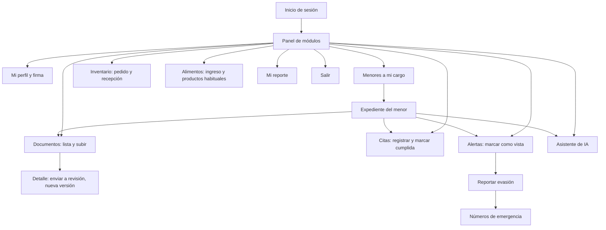
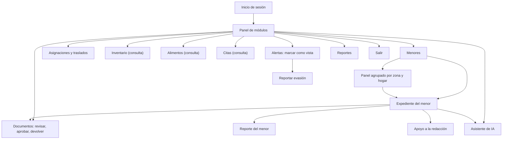
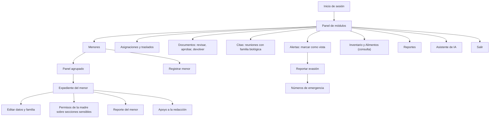
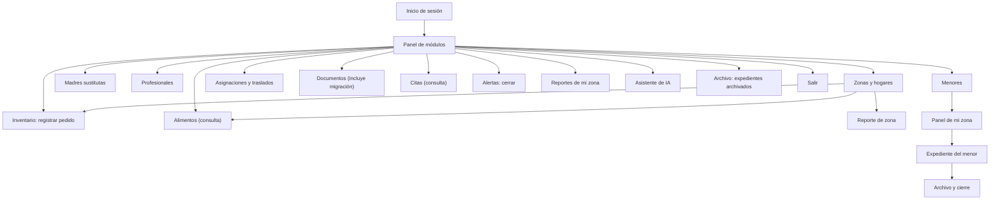
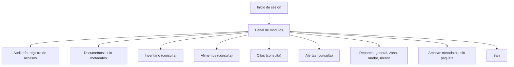
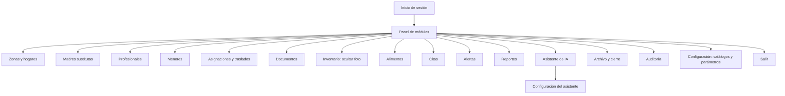

# Inventario de pantallas, navegación y bocetos

Fase 3 (Diseño). Todo lo de este documento sale del código de `frontend/src/app` (rutas en `app.routes.ts`, menú en `core/navegacion.ts`, guards en `core/auth/guards.ts`, componentes en `modules/*` y `features/*`) y de los ADR 0013 a 0015. Lo que no existe en el código se marca **Pendiente**. Los nombres de ejemplo son sintéticos.

## 1. Cómo se decide quién ve qué

- `authGuard` protege todo lo que está bajo el shell: sin sesión se redirige a `/login`.
- `rolGuard('admin')` solo existe en `/configuracion`. Cualquier otro rol vuelve a `/panel`.
- Las demás rutas **no tienen guard por rol**: el rol solo decide qué enlaces aparecen en el menú lateral (`MODULOS` en `navegacion.ts`, marcado "provisional") y qué botones muestra cada componente. Quien escriba la dirección a mano llega a la pantalla; el backend responde 403 si no corresponde. **Pendiente:** guards por ruta si seguridad lo exige.
- El token vive solo en memoria: recargar la página obliga a iniciar sesión otra vez.

### Visibilidad de módulos por rol (de `navegacion.ts`)

| Módulo (ruta) | madre | profesional | defensor | coordinador | auditor | admin |
|---|---|---|---|---|---|---|
| Zonas y Hogares (`zonas-hogares`) | - | - | - | si | - | si |
| Madres Sustitutas (`madres`) | si | - | - | si | - | si |
| Profesionales (`profesionales`) | - | - | - | si | - | si |
| Menores y Expedientes (`menores`) | si | si | si | si | - | si |
| Asignaciones y Traslados (`asignaciones`) | - | si | si | si | - | si |
| Gestión Documental (`documentos`) | si | si | si | si | si | si |
| Inventario del Hogar (`inventario`) | si | si | si | si | si | si |
| Control de Alimentos (`alimentos`) | si | si | si | si | si | si |
| Citas y Recordatorios (`citas`) | si | si | si | si | si | si |
| Alertas y Evasiones (`alertas`) | si | si | si | si | si | si |
| Reportes (`reportes`) | si | si | si | si | si | si |
| Asistente de IA (`ia`) | si | si | si | si | - | si |
| Archivo y Cierre (`archivo`) | - | - | - | si | si | si |
| Auditoría (`auditoria`) | - | - | - | - | si | si |
| Configuración (`configuracion`) | - | - | - | - | - | si (con guard) |

Nota: el brief `docs/ux/brief-google-stitch.md` (sección 4) está desactualizado frente al código: el menú actual da Inventario, Alimentos, Citas y Alertas también a defensor, auditor y admin, y Reportes a la madre. Conviene actualizar el brief.

Además, el asistente de IA flotante (`shared/ia-flotante`) aparece en todas las pantallas del shell para madre, profesional, defensor, coordinador y admin.

## 2. Inventario de pantallas por módulo

Prefijo de API: `/api/v1`. Abreviaturas de rol: Ma madre, Pr profesional, De defensor, Co coordinador, Au auditor, Ad admin.

### Transversal: acceso y estructura

| Ruta | Componente | Propósito | Roles | Acciones principales | Endpoints |
|---|---|---|---|---|---|
| `/login` | `features/login` `Login` | Entrar con correo y contraseña | Público | Iniciar sesión. Muestra "Correo o contraseña incorrectos." si falla. En desarrollo muestra botones de acceso rápido por rol | `POST /auth/login`, `GET /auth/me` |
| (shell) | `features/shell` `Shell` | Barra superior con marca VIKA HOME, correo y rol, botón Salir, menú lateral (se abre con botón en móvil) | Todos los autenticados | Abrir menú, ir a módulo, Salir | Ninguno |
| `/panel` | `features/panel` `Panel` | Inicio: rejilla de tarjetas con los módulos que el rol puede ver | Todos | Entrar a un módulo | Ninguno (usa `MODULOS`) |

Importante: el `/panel` actual **no** muestra alertas, documentos por revisar ni próximas citas. El "panel del profesional" descrito en CLAUDE.md es hoy `/menores/panel` (menores agrupados por zona y hogar). Alertas pendientes y próximas citas viven en sus propios módulos. **Pendiente:** panel de inicio con resumen por rol (alertas sin ver, documentos por revisar, próximas citas).

### 1 Zonas y Hogares

| Ruta | Componente | Propósito | Roles | Acciones | Endpoints |
|---|---|---|---|---|---|
| `/zonas-hogares` | `ZonasHogares` | Crear zonas, listar hogares de una zona, cambiar estado y madre asignada | Co, Ad | Crear zona, crear hogar, guardar cambios del hogar, enlaces a Inventario, Alimentos y Reporte de zona | `GET/POST /zonas-hogares/zonas`, `GET/POST /zonas-hogares/hogares`, `PUT /zonas-hogares/hogares/{id}`, `GET /madres` |

### 2 Madres Sustitutas

| Ruta | Componente | Propósito | Roles | Acciones | Endpoints |
|---|---|---|---|---|---|
| `/madres` (madre) | `Madres` -> `MadresPerfil` | "Mi perfil": datos propios y firma única | Ma | Guardar firma (solo una referencia de texto; ver Pendientes) | `GET /madres/yo`, `PUT /madres/yo/firma` |
| `/madres` (gestión) | `Madres` -> `MadresCoordinador` | Listar, registrar y cambiar estado de certificación de madres | Co, Ad | Registrar madre, cambiar estado de certificación | `GET/POST /madres`, `PUT /madres/{id}` |

### 3 Profesionales

| Ruta | Componente | Propósito | Roles | Acciones | Endpoints |
|---|---|---|---|---|---|
| `/profesionales` | `Profesionales` | Listar, filtrar por cargo, registrar y editar profesionales | Co, Ad | Filtrar, registrar, editar | `GET/POST /profesionales`, `PUT /profesionales/{id}` |

### 5 Menores y Expedientes

| Ruta | Componente | Propósito | Roles | Acciones | Endpoints |
|---|---|---|---|---|---|
| `/menores` | `MenoresLista` | Lista de menores visibles según rol; filtros por zona, hogar y estado | Ma, Pr, De, Co, Ad | Filtrar, abrir expediente. Registrar menor (solo De, Co, Ad). Enlace al panel agrupado (Pr, De, Co) | `GET/POST /menores` |
| `/menores/panel` | `MenoresPanel` | Menores a cargo agrupados por zona y hogar (Pr, De) o por hogar de su zona (Co) | Pr, De, Co (enlace); la ruta no tiene guard | Abrir expediente | `GET /menores/panel/profesional`, `GET /menores/panel/zona` |
| `/menores/:id` | `MenorDetalle` | Expediente: datos básicos, asignación vigente, familia, salud, psicosocial, enlaces a documentos, IA, reportes, archivo, citas, alertas, permisos sobre secciones sensibles, historial de cambios | Ma, Pr, De, Co, Ad | Editar datos básicos y agregar familiar (De, Co, Ad). Otorgar y revocar permisos de la madre (solo De). Enlace a IA (no Au), redacción (Pr, De), archivo (Co, Ad, Au) | `GET/PUT /menores/{id}`, `GET/POST /menores/{id}/familiares`, `GET/POST /menores/{id}/permisos`, `DELETE /menores/{id}/permisos/{pid}`, `GET /menores/{id}/historial`, `GET /documentos/menor/{id}/seccion/{seccion}`, `GET /asignaciones` |

Si el usuario no tiene permiso sobre una sección (familia, salud, psicosocial, permisos) la tarjeta muestra un aviso de falta de acceso en lugar de los datos.

### 6 Asignaciones y Traslados

| Ruta | Componente | Propósito | Roles | Acciones | Endpoints |
|---|---|---|---|---|---|
| `/asignaciones` | `Asignaciones` | Vincular menor y hogar, cerrar por egreso o traslado, ver historial | Pr, De, Co, Ad | Registrar ingreso o traslado, cerrar asignación (fecha, motivo, referencia de acta), ver historial. Hogares y zonas con nombre solo para Co y Ad; los demás ven el id | `GET/POST /asignaciones`, `PUT /asignaciones/{id}/cerrar`, `GET /asignaciones/{id}/historial`, `GET /menores`, `GET /zonas-hogares/*` |

### 7 Gestión Documental

| Ruta | Componente | Propósito | Roles | Acciones | Endpoints |
|---|---|---|---|---|---|
| `/documentos` | `DocumentosLista` | Lista con filtros (menor, hogar, categoría, estado) y formulario "Subir documento" (de un menor o de un hogar) | Ma, Pr, De, Co, Ad (lista y carga); Au (solo metadatos, sin carga) | Filtrar, abrir, subir. Marcar migración con motivo (solo Co, Ad) | `GET /documentos`, `GET /documentos/auditor`, `POST /documentos`, `GET /configuracion/catalogos/*` |
| `/documentos/:id` | `DocumentoDetalle` | Vista previa, metadatos, acciones de flujo y versiones | Los mismos | Enviar a revisión (borrador), Aprobar y Devolver con motivo (en revisión), Subir nueva versión (borrador o devuelto), ver y descargar versiones. Au no ve vista previa ni descargas | `GET /documentos/{id}`, `GET /documentos/{id}/vista`, `GET /documentos/{id}/contenido`, `PUT /documentos/{id}/enviar`, `/aprobar`, `/devolver`, `POST /documentos/{id}/version`, `GET /documentos/{id}/versiones`, `GET /documentos/{id}/versiones/{n}/contenido` |

Nota: en `DocumentoDetalle` los botones Enviar, Aprobar y Devolver dependen solo del estado del documento, no del rol. Quién puede ejecutarlos lo decide el backend (respuesta 403). **Pendiente:** ocultar en pantalla los botones que el rol no puede usar (por ejemplo, que la madre no vea Aprobar).

### 8 Inventario del Hogar (ADR-0014)

| Ruta | Componente | Propósito | Roles | Acciones | Endpoints |
|---|---|---|---|---|---|
| `/inventario` | `Inventario` | Camas y muebles (pedido y recepción), personas que viven en el hogar, red de apoyo | Todos los del menú | Elegir hogar y Cargar. Registrar ítem (el coordinador registra un pedido; los demás, algo que ya está en el hogar). Confirmar recepción con estado al llegar. Cambiar estado (bueno, regular, malo, retirado). Fotos de evidencia con casilla "no muestra a ningún NNA"; Ocultar foto solo Ad. Registrar y desactivar convivientes y red de apoyo | `GET/POST /inventario/items`, `PUT /inventario/items/{id}`, `PUT .../recepcion`, `GET/POST .../fotos`, `GET .../fotos/{fid}`, `PUT .../fotos/{fid}/ocultar`, `GET/POST /inventario/convivientes`, `PUT /inventario/convivientes/{id}`, `GET/POST /inventario/red-apoyo`, `PUT /inventario/red-apoyo/{id}` |

### 9 Control de Alimentos (ADR-0015)

| Ruta | Componente | Propósito | Roles | Acciones | Endpoints |
|---|---|---|---|---|---|
| `/alimentos` | `Alimentos` | Alimentos del hogar, productos habituales (checklist) y registro de ingresos | Todos los del menú ven; solo Ma y Ad modifican | Filtrar (perecedero, consumido, solo vencidos). Registrar ingreso. Marcar consumido. Registrar producto habitual, "Comprar de nuevo", "Ya no compro este producto". Los vencidos se marcan con borde, fondo y texto | `GET/POST /alimentos`, `PUT /alimentos/{id}/consumido`, `GET/POST /alimentos/checklist`, `POST /alimentos/checklist/{id}/comprar`, `PUT /alimentos/checklist/{id}` |

### 10 Citas y Recordatorios (ADR-0015)

| Ruta | Componente | Propósito | Roles | Acciones | Endpoints |
|---|---|---|---|---|---|
| `/citas` | `CitasLista` | Lista de citas con filtros y botón "Ver mis próximas citas". El sistema solo recuerda | Todos los del menú ven | Ma y Ad registran citas médicas, psicosociales u otras y las marcan cumplida o no asistió. De y Ad registran y gestionan reuniones con familia biológica. Las notas pueden salir como "Sin acceso a las notas de esta cita" | `GET /citas`, `GET /citas/proximas`, `POST /citas`, `PUT /citas/{id}/estado` |

### 11 Alertas y Evasiones

| Ruta | Componente | Propósito | Roles | Acciones | Endpoints |
|---|---|---|---|---|---|
| `/alertas` | `AlertasLista` | Alertas sin ver (resaltadas arriba), lista con filtros por menor, tipo (evasión, visita vencida, documento faltante) y estado, quién la vio | Todos los del menú | Marcar como vista (solo el destinatario). Cerrar alerta (Co, Ad o quien la generó). Ver panel (mis menores o mi zona). Botón "Reportar una evasión ahora" | `GET /alertas/mis-pendientes`, `GET /alertas/panel`, `GET /alertas`, `PUT /alertas/{id}/visto`, `PUT /alertas/{id}/cerrar` |
| `/alertas/reportar-evasion` | `ReportarEvasion` | Registrar la evasión y mostrar de inmediato los números de emergencia | Todos los del menú (el backend valida 403) | Elegir menor, escribir "Qué pasó (breve)", "Confirmar y reportar evasión ahora". Resultado: Policía de Infancia y Adolescencia, defensor y psicosocial asignados con teléfono, o aviso si falta | `POST /alertas/evasion` |

### 12 Reportes

| Ruta | Componente | Propósito | Roles | Acciones | Endpoints |
|---|---|---|---|---|---|
| `/reportes` | `ReportesPanel` | Madre: "Mi reporte". Co, Ad, Au: reporte general (el Co ve el de su zona) y acceso a reporte por zona. Pr y De: aviso de que entran desde el expediente | Todos | Ver reporte general, exportar (pantalla JSON, PDF, CSV; no Au), ir a informes exportados | `GET /reportes/general`, `GET /madres/yo`, `GET /reportes/madre/{id}`, `POST /reportes/exportar` |
| `/reportes/zona/:zonaId` | `ReporteZona` | Reporte de una zona | Co, Ad, Au | Exportar (no Au) | `GET /reportes/zona/{id}`, `POST /reportes/exportar` |
| `/reportes/menor/:menorId` | `ReporteMenor` | Reporte de un menor (se llega desde el expediente) | Todos | Exportar (no Au) | `GET /reportes/menor/{id}`, `POST /reportes/exportar` |
| `/reportes/madre/:madreId` | `ReporteMadre` | Reporte de una madre | Ma (propio), Co, Ad, Au | Exportar (no Au) | `GET /reportes/madre/{id}`, `POST /reportes/exportar` |
| `/reportes/exportados` | `ReportesExportados` | Informes ya generados y su descarga | Todos | Descargar | `GET /reportes/exportados`, `GET /reportes/exportados/{id}/contenido` |

### Transversal: Asistente de IA

| Ruta | Componente | Propósito | Roles | Acciones | Endpoints |
|---|---|---|---|---|---|
| `/ia` | `IaConsulta` | Pregunta en lenguaje natural; respuesta con "Fuentes citadas"; historial. Si no hay fuente, avisa que no se envió nada al asistente externo | Ma, Pr, De, Co, Ad | Preguntar, limitar por menor (y por hogar para Co y Ad), ver historial | `POST /ia/consultas`, `GET /ia/consultas`, `GET /menores`, `GET /zonas-hogares/*` |
| `/ia/redaccion` | `ApoyoRedaccion` | Borrador de informe a partir de las notas del profesional, con fuentes | Pr, De (enlace) | Generar y copiar borrador | `GET /menores`, `POST /ia/redaccion/apoyo` |
| `/ia/menores/:menorId/resumen` | `ResumenMenor` | Resumen del expediente con fuentes | Ma, Pr, De, Co, Ad (enlace en el expediente) | Ver resumen | `GET /ia/menores/{id}/resumen` |
| `/ia/estado` | `EstadoIa` | Configuración del proveedor de IA | Ad (enlace) | Solo lectura | `GET /ia/estado` |
| (flotante) | `IaFlotante` | Mismo chat en cualquier pantalla | Ma, Pr, De, Co, Ad | Preguntar, "Ver historial completo" | `POST /ia/consultas` |

### Transversal: Archivo y Cierre

| Ruta | Componente | Propósito | Roles | Acciones | Endpoints |
|---|---|---|---|---|---|
| `/archivo` | `ArchivoLista` | Lista de expedientes archivados (solo metadatos) | Co, Ad, Au | Filtrar, ver detalle | `GET /archivo` |
| `/archivo/menores/:menorId` | `ArchivoMenor` | Estado de archivo del expediente; archivar con confirmación; descargar paquete cifrado | Co, Ad, Au | Archivar (Co, Ad) con aviso de que no se deshace; descargar paquete (no Au) | `GET /archivo/menores/{id}`, `POST /archivo/menores/{id}/cerrar`, `GET /archivo/menores/{id}/paquete` |

### Transversal: Auditoría y Configuración

| Ruta | Componente | Propósito | Roles | Acciones | Endpoints |
|---|---|---|---|---|---|
| `/auditoria` | `Auditoria` | Registro de accesos, solo lectura, con filtros por usuario, acción y fechas | Au, Ad | Filtrar | `GET /auditoria` |
| `/configuracion` | `Configuracion` | Catálogos de opciones (con sección de acceso obligatoria al crear categorías) y parámetros de negocio | Ad (guard) | Editar y crear opciones, cambiar valor de parámetros | `GET /configuracion/catalogos`, `GET/POST /configuracion/catalogos/{grupo}`, `GET .../{grupo}/admin`, `PUT .../{grupo}/{valor}`, `GET /configuracion/parametros`, `PUT /configuracion/parametros/{clave}` |

### No existe todavía (Pendiente)

- Pantalla de recuperar o cambiar contraseña.
- Cierre de sesión por inactividad y aviso previo.
- Registro de firma por imagen o dibujo (hoy solo texto de referencia) y uso de la firma dentro de documentos.
- Pantalla de asignación de profesionales a un menor (el módulo Profesionales solo administra personas).
- Indicación de confianza de la respuesta de IA y botón "reportar error" en la respuesta.
- Notificación al celular o SMS de evasión (punto abierto 7 de CLAUDE.md).
- Modo con poca conectividad (carga reintentable, borradores locales).
- Opciones de tamaño de letra y lectura asistida.

## 3. Mapa de navegación por rol

Todos entran por `/login`, pasan por el shell y llegan a `/panel` (rejilla de módulos). Desde el menú lateral se llega a cada módulo. Los diagramas muestran el menú de cada rol y los saltos entre pantallas más usados.

### Madre sustituta

### Profesional (psicosocial, nutrición, trabajo social)

### Defensor

### Coordinador (su zona)

### Auditor (solo lectura)

### Administrador

## 4. Bocetos de las 6 pantallas clave

Datos de estilo tomados del código: marca "VIKA HOME", turquesa `#18A999` y oscuro `#0d7a6e`, coral `#FF7F6B`, fondo `#F2F7F6`, texto `#344B49`, rojo de emergencia `#b00020`. La paleta definitiva sigue sin decidirse (brief de Stitch, sección 7). Los bocetos describen **lo que ya existe** y, aparte, **mejoras propuestas** marcadas como tales. Prompts en español; sirven igual en Google Stitch o Figma (con un plugin de IA).

### 4.1 Inicio de sesión (`/login`)

Zonas (móvil, una columna; en escritorio dos paneles):
1. Panel de marca: "Plataforma Digital", VIKA HOME, frase corta. En móvil conviene reducirlo a una franja con el logo.
2. Formulario: ícono de candado, título "Bienvenido", nota "Ingresa tus credenciales para continuar".
3. Campo "Correo electrónico" (ejemplo `tu@correo.com`) y campo "Contraseña".
4. Mensaje de error en línea: "Correo o contraseña incorrectos."
5. Botón "Iniciar Sesión" (cambia a "Verificando..." y se bloquea).
6. Solo desarrollo: bloque "Accesos rápidos de desarrollo" (no debe llegar a producción).

Mejoras propuestas (Pendiente): botón para ver la contraseña, texto "Si olvidó su contraseña, hable con su coordinador" (no hay recuperación en el sistema), aviso de que la sesión se cierra por inactividad.

Prompt para Stitch/Figma:
> Pantalla de inicio de sesión móvil para "VIKA HOME", sistema de gestión documental de hogares sustitutos en Colombia. Una sola columna, fondo gris verdoso muy claro (#F2F7F6), tarjeta blanca centrada. Arriba, un espacio para el logo y el nombre VIKA HOME. Título "Bienvenido" con un ícono de candado en trazo (SVG, sin emojis). Dos campos grandes con etiqueta visible encima: "Correo electrónico" y "Contraseña" (con botón de mostrar contraseña). Un mensaje de error en texto con ícono, no solo en color: "Correo o contraseña incorrectos." Botón ancho de 56 px de alto, turquesa oscuro (#0d7a6e) con texto blanco de 18 px: "Iniciar sesión". Debajo, texto pequeño de ayuda: "Si olvidó su contraseña, hable con su coordinador." Tono cálido y sobrio, contraste AA, letra mínima de 16 px, áreas táctiles de 48 px. Sin datos reales.

### 4.2 Panel del profesional (`/menores/panel`)

Zonas:
1. Barra superior (compartida): botón de menú, marca, correo y rol, botón Salir.
2. Encabezado: "Panel de menores a cargo" y enlace "Ver lista completa".
3. Bloques por zona ("Zona 1"), y dentro, subbloques por hogar ("Hogar ..."), cada uno con la lista de tarjetas-enlace "Nombre Apellido - estado".
4. Estados vacíos: "No tiene menores a cargo por ahora."
5. En el coordinador: solo bloques por hogar de su zona.
6. Asistente de IA flotante abajo a la derecha.

Hoy muestra el id de zona y de hogar, no el nombre. Mejoras propuestas (Pendiente): nombre de zona y hogar, contador de alertas sin ver y de documentos por revisar en cada tarjeta, franja de próximas citas, filtro por zona y hogar.

Prompt:
> Panel de inicio para una profesional psicosocial del ICBF, escritorio y móvil. Título "Panel de menores a cargo". Lista agrupada: primero Zona 1 y Zona 2 como secciones; dentro de cada una, Hogar "Los Almendros" y Hogar "El Roble" con tarjetas por niño o niña con nombres ficticios (por ejemplo "Camila Rojas, 8 años") y una etiqueta de estado "Activo". Cada tarjeta muestra dos indicadores con ícono SVG y texto: "1 alerta sin ver" y "2 documentos por revisar". A la derecha (escritorio) o al final (móvil) una franja "Próximas citas" con tres filas. Filtros superiores por zona y hogar. Menú lateral con los módulos de profesional. Paleta turquesa institucional, el rojo solo para alertas, texto 16 px o más, contraste AA, sin emojis.

### 4.3 Expediente del menor (`/menores/:id`)

Zonas (una tarjeta por sección, en este orden):
1. Título con nombre y apellidos; enlace "Volver a la lista".
2. "Datos básicos": nacimiento, género, tipo y número de documento, estado; botón "Editar datos básicos" (defensor, coordinador, admin).
3. "Asignación vigente": hogar y fecha desde; enlace a asignaciones y traslados.
4. "Familia": parentesco, nombres, identificación, teléfono, estado vital; formulario "Agregar familiar" (quien puede editar). Si no hay permiso: aviso de falta de acceso.
5. "Salud" y "Psicosocial": documentos e informes con estado; enlace "Subir o ver documentos ...". Mismo aviso si no hay acceso.
6. "Gestión documental", "Asistente de IA" (resumen, pregunta, redacción), "Reportes", "Archivo y Cierre" (solo coordinador, admin, auditor), "Citas y Recordatorios", "Alertas y Evasiones" con enlace "Reportar una evasión de este menor".
7. "Permisos de la madre sobre secciones sensibles": lista Otorgado o Revocado; el defensor puede otorgar y revocar.
8. "Historial de cambios" (se despliega).

Mejoras propuestas (Pendiente): pestañas o índice fijo en vez de una página larga; datos sensibles ocultos por defecto con botón "Mostrar" que registre el acceso; indicador visible de expediente archivado; el permiso se pide con id de usuario, mejor elegir a la madre por nombre.

Prompt:
> Vista de expediente de una niña ficticia, "Camila Rojas", para profesionales de un hogar sustituto. Encabezado con nombre, edad, etiqueta de estado "Activo" y botón "Volver a la lista". Debajo, navegación por pestañas con scroll horizontal en móvil: Datos básicos, Familia, Salud, Psicosocial, Documentos, Citas, Alertas, Permisos, Historial. La pestaña Datos básicos muestra pares etiqueta-valor con letra 16 px. Las pestañas Familia, Salud y Psicosocial traen por defecto el contenido oculto con un panel "Información sensible. Mostrar" y un texto "Su acceso queda registrado". Si no hay permiso: "No tiene acceso a esta sección." con ícono de candado. A la derecha o abajo, un bloque "Asistente de IA" con tres enlaces: "Resumen del expediente", "Hacer una pregunta", "Apoyo a la redacción". Pie con enlace claro a "Reportar una evasión" en rojo con ícono de alerta. Datos ficticios, trazo de íconos SVG, contraste AA.

### 4.4 Carga y revisión de documento (`/documentos` y `/documentos/:id`)

Carga (lista, madre o profesional):
1. Filtros: menor, hogar, categoría, estado (borrador, en revisión, devuelto, aprobado) y botón Filtrar.
2. Lista de tarjetas: título, categoría, "Estado: ... - Versión N", archivo y tamaño.
3. Formulario "Subir documento": "Este documento es de" (un menor o un hogar), menor u hogar, categoría, título, archivo, botón "Subir documento". Coordinador y admin ven además la casilla de migración con motivo.

Revisión (detalle):
1. Título del documento.
2. "Vista previa" (no para auditor).
3. "Metadatos" y botón de descarga.
4. "Acciones" según estado: borrador -> "Enviar a revisión"; en revisión -> "Aprobar" y "Devolver" (pide "Motivo de la devolución" y "Confirmar devolución"); borrador o devuelto -> "Subir nueva versión (corrige el archivo cargado)"; aprobado -> "Este documento ya está aprobado".
5. "Versiones anteriores": tabla con versión, archivo, estado en ese momento, fecha, calidad, descarga.

Mejoras propuestas (Pendiente): en el celular, botón "Tomar foto" que abra la cámara; aviso de calidad de imagen antes de enviar; mostrar la firma de la madre en el documento; botones según rol.

Prompt:
> Dos pantallas móviles para un sistema de gestión documental. Pantalla A, "Documentos de Camila Rojas" (ficticia): lista de tarjetas con título, categoría, chip de estado (Borrador, En revisión, Devuelto, Aprobado, cada uno con ícono distinto y no solo color) y versión. Botón flotante grande "Subir documento" que abre una hoja inferior con: selector "Este documento es de" (Un menor / Un hogar), categoría, título, y tres botones grandes "Tomar foto", "Elegir PDF", "Elegir Word o Excel". Pantalla B, revisión para la profesional: vista previa del documento ocupando la mitad superior, debajo metadatos (quién lo subió, cuándo, categoría, versión) y dos botones grandes lado a lado, "Aprobar" (turquesa oscuro) y "Devolver" (contorno). Al pulsar Devolver aparece un campo obligatorio "Motivo de la devolución" y "Confirmar devolución". Al final, "Versiones anteriores" como lista desplegable. Textos sencillos en español de Colombia, letra de 16 px o más, contraste AA, sin emojis.

### 4.5 Reporte de evasión con números de emergencia (`/alertas/reportar-evasion`)

Paso 1, formulario:
1. Título "Reportar evasión" y nota: "Use este formulario para registrar que un menor salió del hogar sin autorización. Al confirmar, verá de inmediato en esta misma pantalla los números de emergencia."
2. Selector de menor (obligatorio).
3. "Qué pasó (breve)" (área de texto).
4. Botón "Confirmar y reportar evasión ahora" (grande).
5. Error en línea; el texto genérico dice "Intente de nuevo o llame directamente a los números de emergencia."

Paso 2, resultado (borde rojo grueso, `role="alert"`, anuncio asertivo):
1. "Reporte registrado. Llame ya si hay riesgo inmediato".
2. Policía de Infancia y Adolescencia con teléfono grande.
3. Defensor asignado y Profesional psicosocial asignada: nombre y teléfono grande; si falta teléfono, aviso "No tiene un teléfono registrado en el sistema. Busque otra vía para contactarlo de inmediato."
4. Si no hay ninguno: aviso para usar el número de la Policía y avisar al coordinador.
5. Tarjeta "Alerta creada": estado, descripción, enlace a "Alertas y Evasiones" para ver quién la ha visto.
6. Botón "Registrar otra evasión".

Mejoras propuestas (Pendiente): los teléfonos como enlace `tel:` para llamar con un toque en el celular (hoy son texto); aviso por notificación o SMS (punto abierto 7).

Prompt:
> Pantalla de emergencia móvil, "Reporte registrado. Llame ya si hay riesgo inmediato". Borde rojo grueso (#b00020) y encabezado con ícono de alerta en SVG. Tres tarjetas apiladas, cada una con el cargo en mayúsculas, el nombre ficticio y el número de teléfono en tamaño 28 px, con botón grande "Llamar" (48 px de alto mínimo) al lado: "Policía de Infancia y Adolescencia", "Defensor asignado: Andrés Mejía", "Profesional psicosocial asignada: Lucía Paredes". Una de las tarjetas muestra el caso sin teléfono con el texto "No tiene un teléfono registrado en el sistema. Busque otra vía para contactarlo de inmediato." Debajo, tarjeta "Alerta creada" con estado y un enlace "Ver quién la ha visto". Contraste máximo, rojo reservado solo para esta pantalla, el significado no depende solo del color. Antes, una pantalla gemela con el formulario: selector de menor, campo "Qué pasó (breve)" y botón rojo "Confirmar y reportar evasión ahora".

### 4.6 Inventario y alimentos de la madre (`/inventario`, `/alimentos`)

Inventario:
1. Selector de hogar (para la madre queda fijo en su hogar) y botón Cargar.
2. "Camas y muebles": tarjetas con tipo, descripción, cantidad y etiqueta "Recibido" o "Pedido, aún no llega". Si está pendiente: "Confirmar recepción" con "Estado al llegar" (bueno, regular, malo) y "Confirmar que llegó". Si ya llegó: "Cambiar estado" y desplegable "Fotos de evidencia" con casilla "Confirmo que esta foto no muestra a ningún NNA".
3. "Registrar ítem": tipo (cama, mueble, otro), descripción, cantidad.
4. "Personas que viven en el hogar" y "Red de apoyo": lista, "Marcar que ya no vive aquí" o "Desactivar", y formularios de registro.

Alimentos:
1. Selector de hogar y filtros (perecedero, consumido, "Solo vencidos").
2. Lista: descripción, cantidad, ingreso, perecedero y vence, estado Disponible o Consumido; los vencidos con borde y texto "Este alimento ya está vencido."; botón "Marcar como consumido".
3. "Productos habituales": lista con "Comprar de nuevo" (fecha de ingreso, vencimiento, cantidad, "Confirmar compra"), "Ya no compro este producto" y formulario "Registrar producto habitual".
4. "Registrar ingreso": descripción, fecha, cantidad, unidad, casilla "Es perecedero", vencimiento.

Mejoras propuestas (Pendiente): ordenar por vencimiento más próximo, un resumen "3 alimentos vencen esta semana", dictado de voz para descripciones, que la madre no vea botones de coordinador.

Prompt:
> Dos pantallas móviles para una madre sustituta, español de Colombia, lenguaje muy sencillo. Pantalla A "Alimentos de mi hogar": arriba un resumen "2 vencen esta semana" con ícono de reloj. Lista de tarjetas: "Arroz, 2 kg, no perecedero" y "Leche, 6 litros, vence 25 de noviembre" con chip "Por vencer" (ícono más texto, no solo color) y botón grande "Ya lo consumimos". Sección "Productos que compro seguido" con botón "Comprar de nuevo" que abre una hoja con fecha, vencimiento y cantidad. Botón flotante "Registrar ingreso". Pantalla B "Inventario": tarjetas de camas y muebles, cada una con chip "Pedido, aún no llega" o "Recibido" y un botón "Ya llegó" que pide el estado (Bueno, Regular, Malo); una casilla obligatoria "Confirmo que esta foto no muestra a ningún niño o niña" antes de subir foto. Botones de 48 px o más, letra de 18 px, contraste AA, íconos SVG con etiqueta de texto, sin emojis. Nombres y datos ficticios.

## 5. Criterios de accesibilidad aplicados

Marco: WCAG 2.1 AA, móvil primero, Android y computador, baja visión, alfabetización digital baja a media. La columna "Estado" dice qué se ve hoy en el código.

| Criterio | Qué se aplica | Estado en el código |
|---|---|---|
| Etiquetas visibles | Todo campo con `label` enlazado por `for` e `id` | Cumple en las pantallas revisadas |
| Errores anunciados | Errores con `role="alert"`, éxito con `role="status"`, emergencia con `aria-live="assertive"` | Cumple |
| No depender del color | Vencidos y alertas con texto además de borde y fondo (por ejemplo "Este alimento ya está vencido.") | Cumple en alimentos y alertas |
| Íconos SVG, sin emojis | Íconos en trazo con texto al lado | Casi: el login usa un símbolo de rayo en el bloque de desarrollo y el chat flotante usa el carácter de cierre; la flecha del panel es texto. Reemplazar por SVG |
| Lenguaje sencillo | Mensajes cortos, sin tecnicismos ("Marcar como vista", "Ya no vive aquí") | Cumple en general; hay textos con "NNA", "JSON", "id" que la madre no usa |
| Tamaño táctil | Botones de al menos 48 por 48 px y separación entre ellos | A verificar: botones de menú de 40 px; botones de formulario sin tamaño mínimo declarado |
| Contraste | Texto normal 4.5:1, texto grande 3:1 | A verificar. Estimado: blanco sobre turquesa `#18A999` (etiqueta de rol, ítem activo del menú) queda cerca de 2.9:1 y coral sobre `#FFF0ED` (botón Salir) cerca de 2.2:1; ambos fallan. Usar `#0d7a6e` (cerca de 5.2:1) o más oscuro |
| Baja visión | Letra base de 16 px o más, zoom hasta 200% sin perder contenido, opción de aumentar letra | Parcial: tamaños en `rem`, algunos textos de 0.7 a 0.875 rem. Opción de tamaño de letra: Pendiente |
| Lectura asistida | Lectura en voz alta opcional | Pendiente |
| Teclado y foco | Todo operable con teclado, foco visible, orden lógico, menú con `aria-expanded` | Parcial: menú con `aria-expanded`, el resto depende de los estilos globales; revisar foco visible |
| Lector de pantalla | Títulos jerárquicos (h1, h2, h3), `aria-label` en botones solo-ícono, `alt` en imágenes | Cumple en lo revisado (foto de inventario con `alt`) |
| Móvil primero | Menú lateral que se oculta por debajo de 900 px, una columna | Cumple en el shell; el panel usa tarjetas de mínimo 340 px de ancho, revisar en pantallas de 320 px |
| Conectividad limitada | Mensajes de "Cargando...", errores con salida clara, reintentar | Parcial: hay estados de carga y errores; reintento automático y borradores locales: Pendiente |
| Privacidad en pantalla | Ocultar datos sensibles por defecto, aviso de acceso, cierre por inactividad | Parcial: avisos de "sin acceso" por sección y token solo en memoria. Ocultar por defecto y cierre por inactividad: Pendiente |
| Confirmaciones | Aviso antes de acciones definitivas | Cumple en archivar ("Sí, archivar definitivamente"); revisar devolver y desactivar |

Validar con `seguridad` los cambios de "ocultar por defecto" y "cierre por inactividad", porque afectan datos de menores.

## 6. Hallazgos para el equipo (Pendiente de decisión)

1. El brief de Stitch (`docs/ux/brief-google-stitch.md`) debe ajustarse al menú real (sección 1 de este documento).
2. `/panel` es solo una rejilla de módulos; falta el panel por rol descrito en las reglas de negocio.
3. Varias pantallas muestran ids (hogar, zona, usuario) en lugar de nombres.
4. En el detalle del documento los botones de flujo no se filtran por rol.
5. Las respuestas de IA muestran fuentes pero no nivel de confianza ni forma de reportar un error.
6. La firma se guarda como texto de referencia, no como imagen.
7. Contraste del turquesa claro y del coral a corregir.
