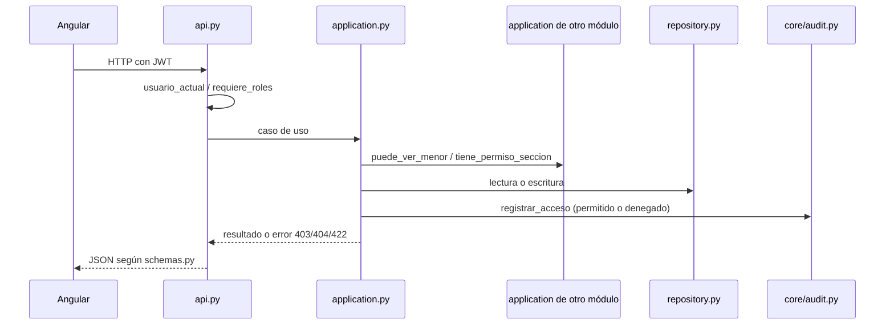

# Lógica de negocio por módulo

Fase 4, paso 2: "Codificar la lógica del negocio de cada módulo siguiendo los diagramas previos".
Casos de uso públicos de cada `backend/app/modules/<modulo>/application.py`, con la regla principal que aplican. Diagramas de referencia en `../02-arquitectura/` y `../03-diseno/`.

| Módulo | Casos de uso | Reglas clave | ADR |
|---|---|---|---|
| 1 auth | `iniciar_sesion`, `usuarios_por_rol` | JWT de 60 min; auditoría de sesión, también de intentos fallidos | 0004 |
| 2 zonas_hogares | `crear/listar/obtener/actualizar_zona`, `crear/listar/obtener/actualizar_hogar`, `hogar_de_madre`, `puede_ver_hogar`, `puede_gestionar_hogar` | Coordinador acotado a su zona; helpers de autorización por hogar que reutilizan inventario y alimentos | 0009 §0 |
| 3 madres | `crear/listar/obtener/actualizar_madre`, `obtener_mi_perfil`, `madre_de_usuario`, `actualizar_mi_firma` | Firma cargada una sola vez por la madre | 0004 |
| 4 profesionales | `crear/listar/obtener/actualizar_profesional`, `esta_asignado_a_menor`, `es_defensor_asignado`, `menores_asignados_a_profesional`, `profesionales_asignados_a_menor` | Fuente de permisos y destinatarios de alertas | 0007 |
| 5 menores | `crear/listar/obtener/actualizar_menor`, `historial_menor`, `crear/listar_familiar`, `crear/listar/revocar_permiso`, `panel_profesional`, `panel_zona`, `puede_ver_menor`, `tiene_permiso_seccion`, `actualizar_estado_por_cierre` | Denegar por defecto; solo el defensor otorga permisos; snapshot en `menores_history` antes de cada cambio | 0007 |
| 6 asignaciones | `crear_asignacion`, `cerrar_asignacion`, `vigente_de_menor`, `listar_asignaciones_visibles`, `historial_asignacion` | Una vigente por NNA; traslado atómico; al cerrar revoca permisos de la madre | 0007 |
| 7 documentos | `crear_documento`, `enviar/aprobar/devolver_documento`, `crear_version`, `listar_versiones`, `descargar_documento`, `visualizar_documento`, `seccion_expediente`, `listar_para_auditor`, `crear/listar/obtener_reporte`, `esta_archivado` | Cifrado Fernet y hash; flujo borrador, en revisión, aprobado, devuelto; versión previa a `documentos_versiones`; auditor sin contenido | 0008, 0011 |
| 8 inventario | `crear_item`, `actualizar_item`, `confirmar_recepcion_item`, `subir/listar/obtener/ocultar_foto_item`, convivientes y red de apoyo | Coordinador pide, madre recibe una vez; fotos cifradas con declaración | 0009, 0014 |
| 9 alimentos | `crear_alimento`, `marcar_consumido`, checklist (`crear/listar/actualizar_checklist_item`, `comprar_de_checklist`) | Escritura solo madre o admin; perecedero exige vencimiento | 0009, 0014, 0015 |
| 10 citas | `crear_cita`, `actualizar_cita`, `cambiar_estado_cita`, `listar_proximas`, `puede_ver_notas`, `citas_vencidas_pendientes` | Dueño por tipo (madre o defensor); notas ocultas sin permiso de sección | 0009, 0015 |
| 11 alertas | `reportar_evasion`, `marcar_visto`, `cerrar_alerta`, `generar_automaticas`, `mis_pendientes`, `panel` | Destinatarios defensor y psicosocial con respaldo; nunca cero; `visto_en` por destinatario; generación idempotente | 0009 |
| T4 configuracion | catálogos (`listar/crear/actualizar_opcion_catalogo`, `valor_valido_en_catalogo`, `seccion_acceso_de_opcion`), parámetros (`obtener/actualizar_parametro`, `listar_parametros_publicos`) | Escritura solo admin; valor nuevo sin mapeo queda con visibilidad mínima | 0013 |
| 12 reportes | `reporte_general/zona/menor/madre`, `exportar_informe`, `listar_exportados`, `obtener_contenido_exportado` | Mismo control que en pantalla; revalida permisos al descargar | 0010 §2 |
| T1 ia | `consultar`, `resumen_menor`, `resumen_documento`, `apoyo_redaccion`, `clasificar_contenido`, `indexar_*`, `reindexar_pendientes`, `evaluar_documento_faltante`, `estado` | Filtra por permisos antes de recuperar; cita obligatoria; seudonimización; revalida al leer historial | 0002, 0003, 0010 §1 |
| T2 auditoria | `listar_accesos` (más `core/audit.py::registrar_acceso` usado por todos) | Registro de solo inserción | 0004 |
| T3 archivo | `cerrar_expediente`, `obtener_estado`, `obtener_paquete`, `listar_archivados`, `esta_archivado` | Solo egresado o fallecido sin asignación vigente; paquete ZIP cifrado con manifiesto; solo lectura después | 0010 §3 |

## Flujo de una petición

## Pendientes de desarrollo (de las historias de usuario)
HU03 pantalla de cambio de contraseña (la API ya existe), HU05 administración de usuarios, HU12 capacitaciones de la madre, HU14 asignar profesionales a un NNA desde la aplicación, HU54 lista de documentos obligatorios, HU56 SMS o push, HU73 envío al destino final.
