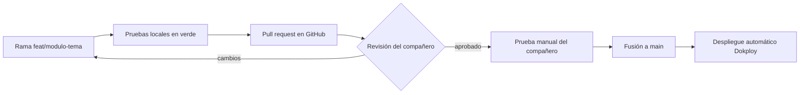

# Revisión de código cruzada

Fase 4, paso 4: "Hacer revisiones de código cruzadas entre los dos integrantes". Regla Kanban: máximo una tarea activa por persona; no se programa nada cuyo diseño no esté aprobado.

## Flujo

Autor y revisor nunca son la misma persona. Si el cambio toca datos de menores, además se revisa con el agente `seguridad` antes de aprobar.

## Lista de verificación del revisor
**Diseño**
- [ ] Existe la historia de usuario y, si cambia la arquitectura o un contrato, su ADR.
- [ ] La migración está antes del código que la usa y no modifica una migración ya aplicada.

**Reglas del monolito modular**
- [ ] `api.py` no tiene reglas de negocio; la autorización está en `application.py`.
- [ ] El módulo solo llama a la capa `application` de otros módulos, nunca a su `repository`.

**Seguridad y datos**
- [ ] Toda lectura y escritura de expediente pasa por `puede_ver_menor` o `tiene_permiso_seccion` y registra auditoría, también al denegar.
- [ ] El auditor no recibe contenido.
- [ ] No hay borrado físico; los cambios generan historial o versión.
- [ ] No hay secretos, datos reales ni datos sensibles en logs.

**Contrato y pruebas**
- [ ] `openapi.json` regenerado y tipos del frontend actualizados (`npm run api:types`).
- [ ] Hay pruebas del caso feliz y de al menos un caso de acceso denegado.
- [ ] `pytest` y `npm test` pasan; `npm run build` compila.

**Interfaz**
- [ ] Textos sencillos, sin emojis, íconos SVG, objetivos táctiles grandes, contraste AA.

## Definición de hecho
Una historia pasa a "Probado" cuando: cumple sus criterios de aceptación, la revisó y probó el compañero, las pruebas automatizadas pasan y no rompe otros módulos (suite completa en verde).
